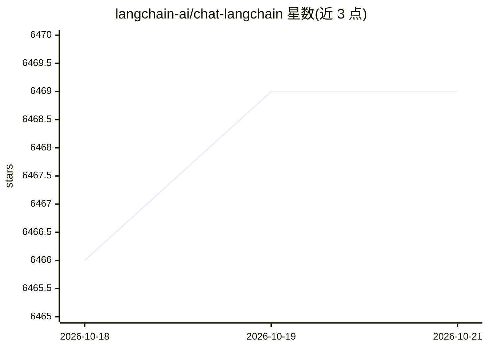

# langchain-ai/chat-langchain

⭐ 6,469 · TypeScript · MIT · 推送 2026-10-19 · [GitHub](https://github.com/langchain-ai/chat-langchain) · [官网](https://chat.langchain.com) · 组织维护

**回答 LangChain 系列文档问题的生产级文档助手 Agent**

由 LangChain 团队维护的文档问答助手，以 Managed Deep Agent 形式部署，面向询问 LangChain、LangGraph、LangSmith 文档问题的用户。工作流为：护栏过滤非相关提问→经托管 MCP 检索官方文档→检索 Pylon 支持知识库→校验 URL 后合成回答。附 Next.js 前端聊天界面，用户认证经 Supabase，由 MDA 校验 token 并隔离会话。需配置 Anthropic 与 Pylon 的 API key，通过 mda dev 本地运行或 mda deploy 部署。

## 筛选速览

| 维度 | 判定 | 备注 |
|---|---|---|
| AI 角色 | `ai-native` | 本体是模型或模型工具 |
| 许可风险 | `permissive` | MIT |
| 部署形态 | `None` |  |
| 模型依赖 | — | README 未给出锁定关系 |
| 硬件要求 | — | 无带数字的原话,不猜 |
| 安装摩擦 | `low` | 无编译、无系统依赖或容器化 |
| 成熟度 | — | 结构信号不足 |

## 能力要点

- 护栏过滤非 LangChain 相关提问
- 经托管 MCP 检索官方文档 + Pylon 支持知识库
- 回答前校验 URL 有效性
- Supabase 认证 + MDA 多区域身份校验与会话隔离

## 适用场景

- 查询 LangChain/LangGraph/LangSmith 文档获得带出处的回答
- 参考其结构构建自己的生产级文档助手 Agent
- 了解 Managed Deep Agents 的部署与身份管理模式

## 场景标签

`文档问答` · 领域:知识与检索

## 证据(README 行号)

> L3: > A documentation assistant deployed as a Managed Deep Agent.
> L11: This is a documentation assistant agent that helps answer questions about LangChain, LangGraph, and LangSmith. It d

## 星数曲线

2026-10-18 6,466 → 2026-10-21 6,469（+3）

---
*卡片 v1 · prompt 1.4 · 生成 2026-10-20 · 置信度 high · 依据 README sha `1cbb9db5449d` · [字段定义](../../DATASET.md)*
