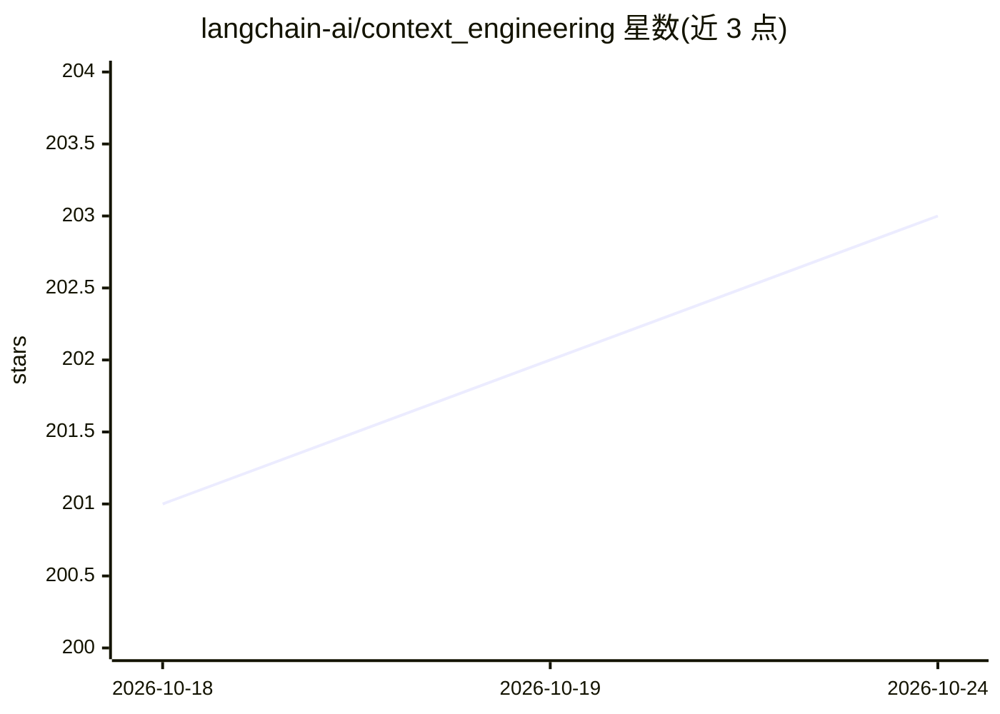

# langchain-ai/context_engineering

⭐ 203 · Jupyter Notebook · 推送 2026-07-27 · [GitHub](https://github.com/langchain-ai/context_engineering) · 组织维护

**LangGraph 上下文工程教学笔记本集（写/选/压/隔离四策略）**

LangChain 官方团队维护的上下文工程教学仓库，包含 4 个 Jupyter 笔记本，分别演示 write（scratchpad/checkpoint/记忆）、select（记忆检索/RAG 工具检索/知识检索）、compress（对话摘要/工具输出压缩）、isolate（多智能体/沙箱/状态隔离）四类策略，并解释 LangGraph 对各策略的支撑方式。运行需 Python 3.9+、uv 包管理器与 OpenAI/Anthropic API key；Deno 仅为可选 legacy 沙箱示例所需。

## 筛选速览

| 维度 | 判定 | 备注 |
|---|---|---|
| AI 角色 | `ai-knowledge` | 知识聚合/清单类 |
| 许可风险 | `none` | — |
| 部署形态 | `library` | 以包/库形式分发 |
| 模型依赖 | — | README 未给出锁定关系 |
| 硬件要求 | — | 无带数字的原话,不猜 |
| 安装摩擦 | `low` | 无编译、无系统依赖或容器化 |
| 成熟度 | — | 结构信号不足 |

## 能力要点

- 4 个策略笔记本：write/select/compress/isolate
- 覆盖 scratchpad、checkpoint、InMemoryStore 长期记忆
- 演示 RAG 工具检索与语义工具匹配（LangGraph Bigtool）
- 对话摘要压缩示例展示 token 从 115k 降至 60k

## 适用场景

- 学习如何在 LangGraph 中管理 agent 上下文窗口
- 为长程 agent 任务设计记忆与压缩方案
- 参考多智能体隔离上下文的实现模式

## 场景标签

`教程课程` · 领域:学习与行业

## 证据(README 行号)

> L3: Agents need context (e.g., instructions, external knowledge, tool feedback) to perform tasks. Context engineering is
> L34: 4. You can then run the notebooks in the `context_engineering` folder:

## 星数曲线

2026-10-18 201 → 2026-10-24 203（+2）

---
*卡片 v1 · prompt 1.4 · 生成 2026-10-22 · 置信度 mid · 依据 README sha `d05568b65256` · [字段定义](../../DATASET.md)*
