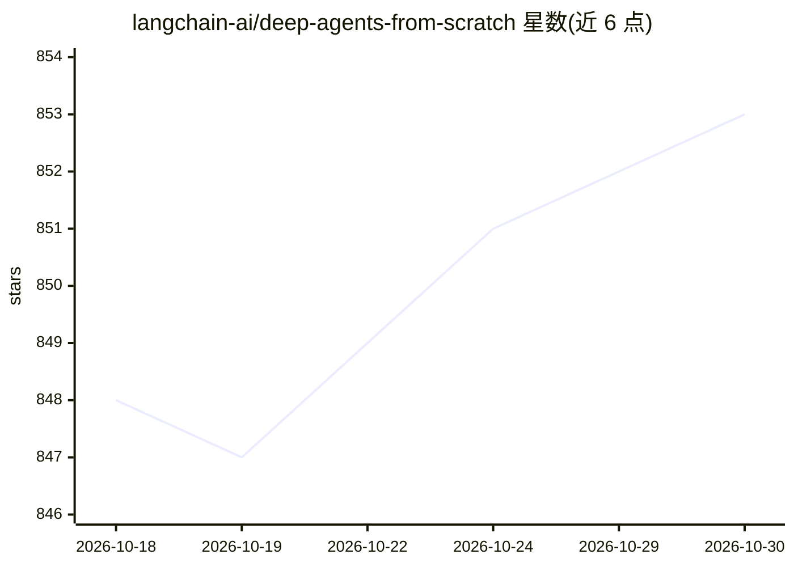

# langchain-ai/deep-agents-from-scratch

⭐ 853 · Jupyter Notebook · MIT · 推送 2026-08-11 · [GitHub](https://github.com/langchain-ai/deep-agents-from-scratch) · 组织维护

**用 LangGraph 从零实现深度 Agent 模式的教学课程**

LangChain 官方团队维护的教学仓库：通过 5 个渐进式 Jupyter notebook 讲解深度 Agent 的上下文工程模式——任务规划（TODO 列表与状态管理）、向文件系统卸载上下文（虚拟文件系统存储于 agent state）、子代理委派实现上下文隔离，最终组合为完整研究 Agent（含真实网络搜索、LangGraph Studio 集成）。使用前需 Python 3.11+、uv 包管理器，克隆仓库后 uv sync 安装，配置 Tavily 等环境变量 API key。

## 筛选速览

| 维度 | 判定 | 备注 |
|---|---|---|
| AI 角色 | `ai-knowledge` | 知识聚合/清单类 |
| 许可风险 | `permissive` | MIT |
| 部署形态 | `None` |  |
| 模型依赖 | — | README 未给出锁定关系 |
| 硬件要求 | — | 无带数字的原话,不猜 |
| 安装摩擦 | `low` | 无编译、无系统依赖或容器化 |
| 成熟度 | — | 结构信号不足 |

## 能力要点

- 5 个渐进式 notebook：ReAct 循环、TODO 规划、虚拟文件系统、子代理委派、完整研究 Agent
- 基于 LangGraph 从零实现任务规划/上下文卸载/上下文隔离三类模式
- 最终 notebook 组合为带真实网络搜索与 LangGraph Studio 集成的研究 Agent

## 适用场景

- 学习 Manus、Claude Code 等深度 Agent 背后的上下文工程模式
- 跟随 notebook 实践构建带规划、文件系统与子代理的 Agent
- 了解如何在 LangGraph 上组装完整研究 Agent

## 场景标签

`教程课程` · 领域:学习与行业

## 证据(README 行号)

> L11: This course will show how to implement these patterns from scratch using LangGraph!
> L68: This repository contains five progressive notebooks that teach you to build advanced AI agents:

## 星数曲线

2026-10-18 848 → 2026-10-30 853（+5）

---
*卡片 v1 · prompt 1.4 · 生成 2026-10-21 · 置信度 high · 依据 README sha `3278c954cf51` · [字段定义](../../DATASET.md)*
