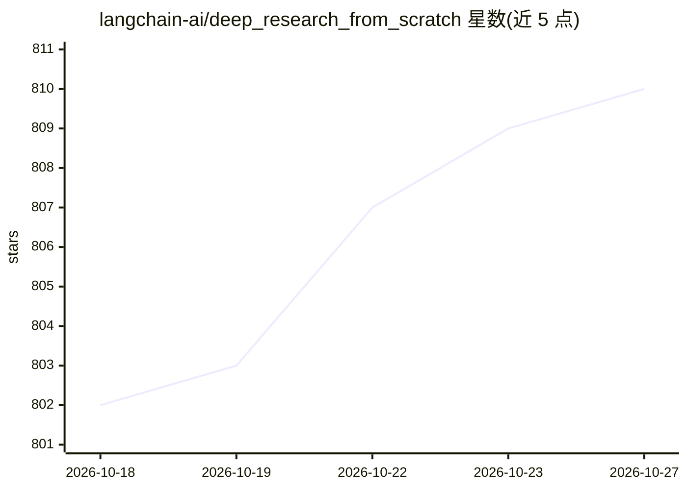

# langchain-ai/deep_research_from_scratch

⭐ 810 · Jupyter Notebook · MIT · 推送 2026-08-11 · [GitHub](https://github.com/langchain-ai/deep_research_from_scratch) · 组织维护

**从零构建深度研究 agent 的 LangGraph 教程（5 个 notebook）**

LangChain 官方团队的教学仓库，用 5 个递进式 Jupyter notebook 从零构建深度研究系统：用户澄清与简报生成、带外部搜索（Tavily）的研究 agent、MCP 服务器工具集成、supervisor 多 agent 协调，最终整合为 Scope→Research→Write 三阶段端到端系统。支持自带模型、搜索工具与 MCP 服务器。运行需 Python 3.11+、uv 与 Node.js（用于 MCP server），需配置 API key。面向学习 agent 架构的开发者。

## 筛选速览

| 维度 | 判定 | 备注 |
|---|---|---|
| AI 角色 | `ai-knowledge` | 知识聚合/清单类 |
| 许可风险 | `permissive` | MIT |
| 部署形态 | `None` |  |
| 模型依赖 | — | README 未给出锁定关系 |
| 硬件要求 | — | 无带数字的原话,不猜 |
| 安装摩擦 | `low` | 无编译、无系统依赖或容器化 |
| 成熟度 | — | 结构信号不足 |

## 能力要点

- 5 个递进 notebook：澄清简报→搜索 agent→MCP→supervisor→完整系统
- 三阶段架构 Scope → Research → Write 产出研究报告
- MCP 服务器作为研究工具集成（MultiServerMCPClient）
- 可配置：自带模型、搜索工具与 MCP 服务器

## 适用场景

- 学习用 LangGraph 构建多 agent 研究系统
- 参考 supervisor 模式与并行研究协调的实现
- 了解 MCP 服务器作为 agent 工具的接入方式

## 场景标签

`教程课程` `多智能体` · 领域:Agent 开发

## 证据(README 行号)

> L80: This repo contains 5 tutorial notebooks that build a deep research system from scratch:
> L3: Deep research has broken out as one of the most popular agent applications. OpenAI, Anthropic, Perplexity, and Googl

## 星数曲线

2026-10-18 802 → 2026-10-27 810（+8）

---
*卡片 v1 · prompt 1.4 · 生成 2026-10-21 · 置信度 high · 依据 README sha `64ebff303cea` · [字段定义](../../DATASET.md)*
