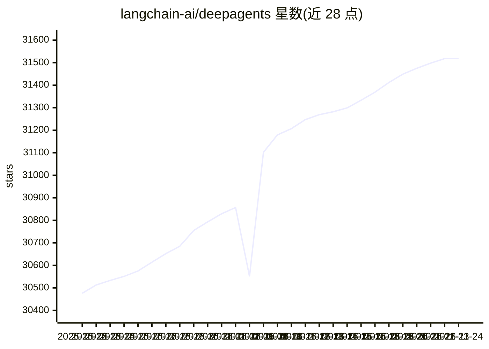

# langchain-ai/deepagents

⭐ 31,518 · Python · MIT · 推送 2026-11-22 · [GitHub](https://github.com/langchain-ai/deepagents) · [官网](https://docs.langchain.com/deepagents) · 组织维护

**开箱即用的 agent 框架：文件系统、子代理与上下文管理**

基于 LangGraph 的 Python/TypeScript 库，提供带默认配置的长程多步 agent 封装：子代理上下文隔离、可插拔文件系统后端、上下文压缩、shell 执行、持久记忆、human-in-the-loop 工具审批、可加载的 Skills 与自定义工具/MCP 接入。模型无关，任何支持 tool calling 的 LLM 均可用。另有终端编码代理 Deep Agents Code（curl 安装脚本）。安全模型为信任 LLM，需在工具/沙箱层自行设界。

## 筛选速览

| 维度 | 判定 | 备注 |
|---|---|---|
| AI 角色 | `ai-ecosystem` | LLM/agent 周边工具 |
| 许可风险 | `permissive` | MIT |
| 部署形态 | `library` | 以包/库形式分发 |
| 模型依赖 | local-ok | 支持本地模型 |
| 硬件要求 | — | 无带数字的原话,不猜 |
| 安装摩擦 | `low` | 无编译、无系统依赖或容器化 |
| 成熟度 | — | 结构信号不足 |

## 动量与使用信号

- 维护:`active` — 距上次 push 1.0 天,年发版 100,160 位贡献者
- 涨星:近 1 天 **+39**(自 20261016 起算)
- 平台:WINDOWS · 协议:MCP / OLLAMA

## 能力要点

- 子代理隔离上下文窗口的委派机制
- 可插拔文件系统后端与上下文压缩
- human-in-the-loop 工具调用审批
- 任意支持 tool calling 的 LLM 可接入

## 适用场景

- 搭建长程多步任务的开箱即用 agent
- 通过子代理委派隔离复杂任务上下文
- 接入自有工具或 MCP 服务器扩展代理能力

## 场景标签

`Agent 框架` `多智能体` · 领域:Agent 开发

## 证据(README 行号)

> L14: Deep Agents is an open source agent harness — an opinionated agent that runs out of the box. Extend, override, or r
> L59: ### How is this different from LangGraph or LangChain?
> L65: Yes. Any model that supports tool calling works — frontier APIs (OpenAI, Anthropic, Google), open-weight models hos

## 星数曲线

2026-10-22 30,476 → 2026-11-24 31,518（+1,042）

---
*卡片 v1 · prompt 1.4 · 生成 2026-11-22 · 置信度 high · 依据 README sha `722cdce6e738` · [字段定义](../../DATASET.md)*
