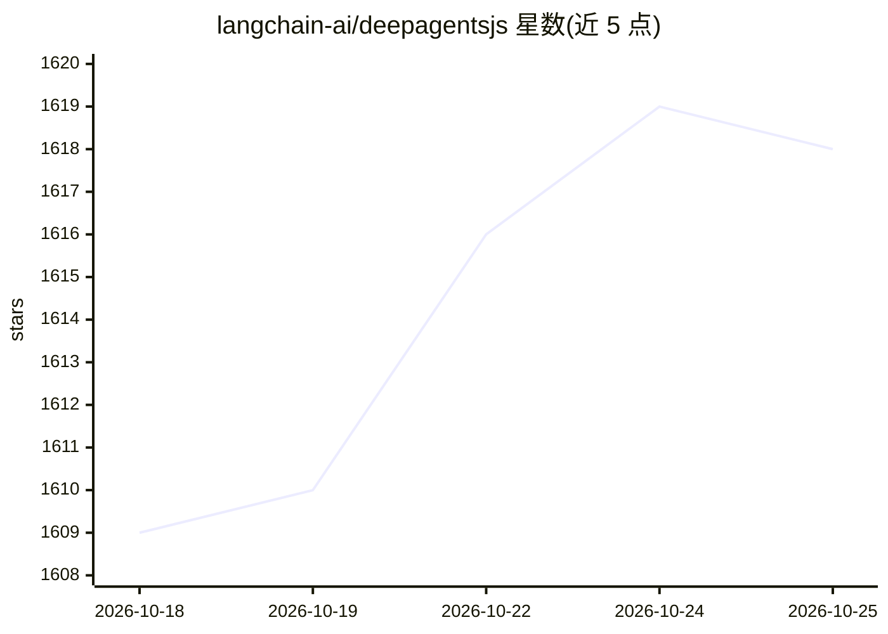

# langchain-ai/deepagentsjs

⭐ 1,618 · TypeScript · MIT · 推送 2026-10-24 · [GitHub](https://github.com/langchain-ai/deepagentsjs) · [官网](https://docs.langchain.com/oss/javascript/deepagents/overview) · 组织维护

**面向 JavaScript 开发者的开箱即用 AI agent 框架**

LangChain 团队以 TypeScript 发布的 agent harness：内置规划（write_todos）、文件系统工具（read/write/edit_file、ls、glob、grep）、子代理委派与上下文管理，安装后即得到可运行的 agent，可按需替换模型、增加工具与自定义提示。createDeepAgent 返回编译后的 LangGraph 图，支持流式、Studio 与 checkpointers；发布 Node、浏览器等多环境入口，模型提供方不限定（需支持工具调用）。安全上遵循“信任 LLM”模型，需在工具/沙箱层面设界。

## 筛选速览

| 维度 | 判定 | 备注 |
|---|---|---|
| AI 角色 | `ai-ecosystem` | LLM/agent 周边工具 |
| 许可风险 | `permissive` | MIT |
| 部署形态 | `library` | 以包/库形式分发 |
| 模型依赖 | — | README 未给出锁定关系 |
| 硬件要求 | — | 无带数字的原话,不猜 |
| 安装摩擦 | `low` | 无编译、无系统依赖或容器化 |
| 成熟度 | — | 结构信号不足 |

## 能力要点

- 内置规划、文件系统工具、子代理与上下文管理
- createDeepAgent 返回编译后的 LangGraph 图，支持流式与持久化
- 提供 Node/browser/node 多环境入口点
- 模型提供方不限定，适配任意支持工具调用的聊天模型

## 适用场景

- 快速搭建带规划与文件工作记忆的 AI agent
- 在 LangGraph 应用中嵌入开箱即用的 agent 运行时
- 浏览器或 Node 环境中运行可自定义工具与模型的 agent

## 场景标签

`Agent 框架` · 领域:Agent 开发

## 证据(README 行号)

> L14: Deep Agents is an agent harness. An opinionated, ready-to-run agent out of the box. Instead of wiring prompts, tool
> L88: `createDeepAgent` returns a compiled LangGraph graph, so you can use streaming, Studio, checkpointers, and other La

## 星数曲线

2026-10-18 1,609 → 2026-10-25 1,618（+9）

---
*卡片 v1 · prompt 1.4 · 生成 2026-10-21 · 置信度 high · 依据 README sha `9021f050655e` · [字段定义](../../DATASET.md)*
