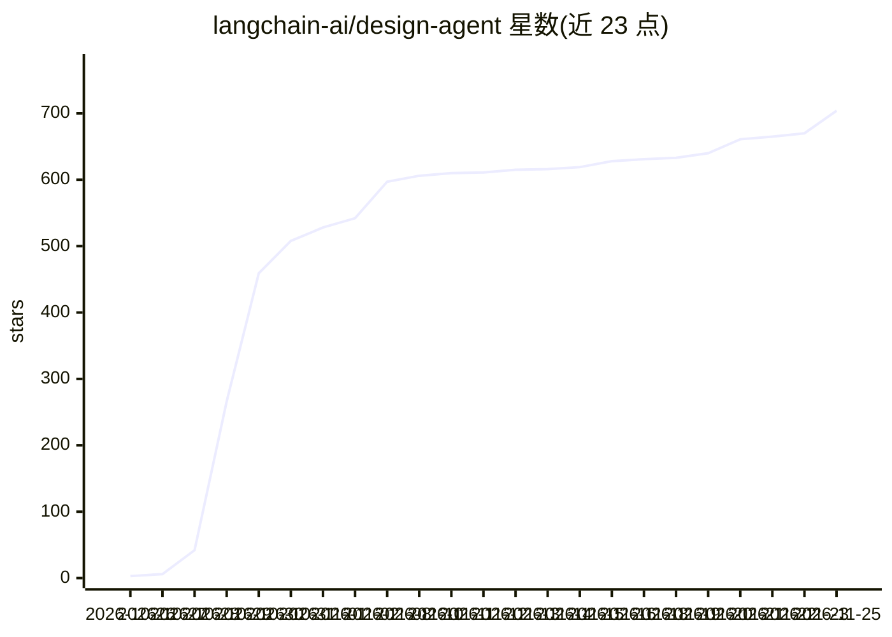

# langchain-ai/design-agent

⭐ 704 · JavaScript · Apache-2.0 · 推送 2026-11-23 · [GitHub](https://github.com/langchain-ai/design-agent) · 组织维护 · 中文 README

**面向团队的品牌设计 agent：对话中产出成品设计文件**

LangChain 开源的 Content Studio 设计 agent，基于 Deep Agents 构建，通过 Slack 线程接收简报与附件，产出符合品牌规范的图片、幻灯片、图表、图示与动态影像。每个线程获得独立 LangSmith Linux 沙箱（含 Chrome、FFmpeg、HyperFrames、D2），产出物均为代码（幻灯片为 HTML、影片为动画时间线）；35 个技能按需路由加载，品牌包与设计 wiki 提供规范，渲染后自查颜色/字体/对比度，支持团队与个人双层记忆及任务后学习笔记。部署依赖 LangSmith 账户（Managed Deep Agents 公测）与模型密钥。

## 筛选速览

| 维度 | 判定 | 备注 |
|---|---|---|
| AI 角色 | `ai-native` | 本体是模型或模型工具 |
| 许可风险 | `permissive` | Apache-2.0 |
| 部署形态 | `None` |  |
| 模型依赖 | — | README 未给出锁定关系 |
| 硬件要求 | — | 无带数字的原话,不猜 |
| 安装摩擦 | `medium` | 含编译或系统依赖之一 |
| 成熟度 | — | 结构信号不足 |

## 能力要点

- Slack 线程内交付成品：改尺寸广告、发布会影片、图表、字幕等
- 每线程独立沙箱，产出物为代码，修改即编辑重渲染
- 35 个技能按需加载，品牌包约束布局与视觉 token
- 渲染后机器可查项代码校验，并支持异步子代理分工

## 适用场景

- 在 Slack 中像找设计师一样要一张多平台尺寸的发布卡片
- 从 CSV 生成团队周报图表
- 制作带音乐与音效的产品宣传影片
- 为网络研讨会视频生成字幕

## 场景标签

`图像生成` `视频生成` · 领域:内容生成

## 证据(README 行号)

> L17: **Content Studio is the design agent LangChain runs, now open source.** Add your brand and deploy it
> L35: Content Studio is a Deep Agents agent deployed on
> L19: get finished, on-brand files back, from a resized ad to a launch film.

## 星数曲线

2026-10-26 3 → 2026-11-25 704（+701）

---
*卡片 v1 · prompt 1.4 · 生成 2026-11-25 · 置信度 high · 依据 README sha `5c3e99cd87c7` · [字段定义](../../DATASET.md)*
