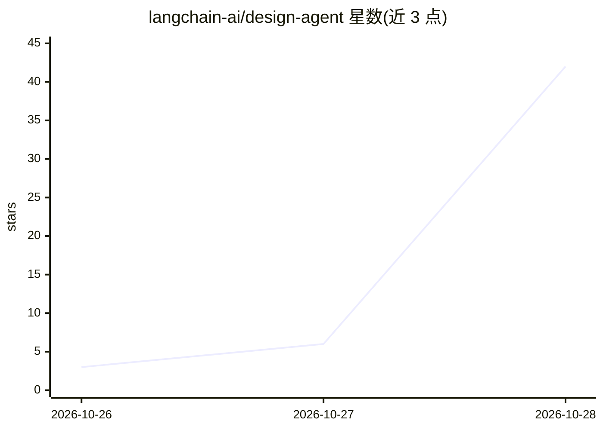

# langchain-ai/design-agent

⭐ 266 · JavaScript · Apache-2.0 · 推送 2026-10-27 · [GitHub](https://github.com/langchain-ai/design-agent) · 组织维护

**品牌设计 agent：从 Slack 对话生成合规图片、幻灯片、图表与视频**

LangChain 开源的设计代理（Content Studio），基于 Deep Agents 构建、部署于 Managed Deep Agents。用户在 Slack 提需求并附素材，代理经 35 个技能路由选择工作流，在独立 Linux 沙箱（含 Chrome、FFmpeg、HyperFrames、D2）中以代码渲染产出符合品牌规范的成品文件；渲染后在代码中校验颜色、字体、对比度与图表数值。支持团队/个人双层记忆、异步子代理、MCP 工具接入（Notion、Figma 等）。需 LangSmith 账号与模型 API key；提供无 key 的本地 Docker 演示。默认模型 Claude Opus 5.5，也支持 OpenAI、Google 及 OpenAI 兼容端点。

## 筛选速览

| 维度 | 判定 | 备注 |
|---|---|---|
| AI 角色 | `ai-native` | 本体是模型或模型工具 |
| 许可风险 | `permissive` | Apache-2.0 |
| 部署形态 | `None` |  |
| 模型依赖 | — | README 未给出锁定关系 |
| 硬件要求 | — | 无带数字的原话,不猜 |
| 安装摩擦 | `medium` | 含编译或系统依赖之一 |
| 成熟度 | `idea` | |

## 能力要点

- 35 个技能路由选择工作流，覆盖广告图、长幻灯片、动画影片
- 渲染后以代码校验颜色/字体/对比度/图表数值的品牌合规
- 每线程独立沙箱（Chrome、FFmpeg、HyperFrames、D2），产出皆为可编辑代码
- 团队与个人双层记忆，任务后自动沉淀经验笔记

## 适用场景

- 团队在 Slack 中直接向代理提设计需求并拿到品牌合规文件
- 把重复性设计请求（改尺寸、周报头图）交给代理处理
- 本地无 API key 用 Docker 演示验证代理工作流程

## 场景标签

`图像生成` `视频生成` · 领域:内容生成

## 证据(README 行号)

> L15: **Content Studio is the design agent LangChain runs, now open source.** Add your brand and deploy it
> L33: Content Studio is a Deep Agents agent deployed on
> L36: repo is the design agent on top. The model makes the creative calls, and code renders, checks and

## 星数曲线

2026-10-26 3 → 2026-10-28 42（+39）

---
*卡片 v1 · prompt 1.4 · 生成 2026-10-28 · 置信度 high · 依据 README sha `1499989493bc` · [字段定义](../../DATASET.md)*
