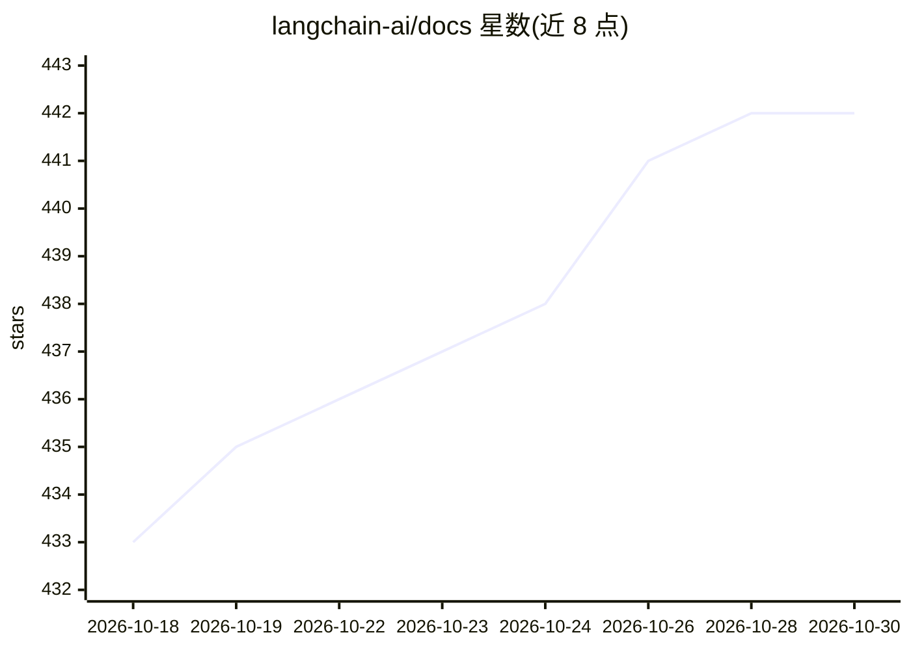

# langchain-ai/docs

⭐ 442 · MDX · MIT · 推送 2026-10-29 · [GitHub](https://github.com/langchain-ai/docs) · [官网](https://docs.langchain.com) · 组织维护

**LangChain 全家桶官方文档仓库与构建管线**

LangChain 官方统一文档仓库，聚合 LangChain、LangGraph、LangSmith 及 LangChain Labs 项目的文档，托管于 Mintlify 构建的 docs.langchain.com；API reference 站点（reference.langchain.com）在仓库外生成。提供 make 工作流（install/dev/build/lint/test）与 docs CLI（MkDocs/Docusaurus 迁移、移动文件并更新引用），支持 Vale 文风检查、Codespell 拼写检查、离线导出与 htmltest。面向文档贡献者与生态使用者。

## 筛选速览

| 维度 | 判定 | 备注 |
|---|---|---|
| AI 角色 | `ai-knowledge` | 知识聚合/清单类 |
| 许可风险 | `permissive` | MIT |
| 部署形态 | `library` | 以包/库形式分发 |
| 模型依赖 | — | README 未给出锁定关系 |
| 硬件要求 | — | 无带数字的原话,不猜 |
| 安装摩擦 | `medium` | 含编译或系统依赖之一 |
| 成熟度 | — | 结构信号不足 |

## 能力要点

- 集中 LangChain/LangGraph/LangSmith/Labs 的文档与 Mintlify 构建管线
- docs CLI 提供 MkDocs 与 Docusaurus 格式迁移及引用更新
- 完整的 lint/test/断链检查/离线导出工具链

## 适用场景

- 本地预览并贡献 LangChain 官方文档
- 将旧格式文档迁移到 Mintlify 格式
- 运行断链与文风检查以保证文档质量

## 场景标签

 · 领域:LLM 生态/开发者文档

## 证据(README 行号)

> L3: 🦜 **Welcome!** This repository contains the documentation build pipeline for LangChain projects.
> L5: * 🏠 `docs.langchain.com` is our docs home, centralizing documentation for LangChain, LangGraph, LangSmith, and LangC
> L6: * 🛠️ `reference.langchain.com` hosts generated API reference for LangChain, LangGraph, LangSmith, and integration pa

## 星数曲线

2026-10-18 433 → 2026-10-30 442（+9）

---
*卡片 v1 · prompt 1.4 · 生成 2026-10-21 · 置信度 mid · 依据 README sha `feed82b8a5b4` · [字段定义](../../DATASET.md)*
