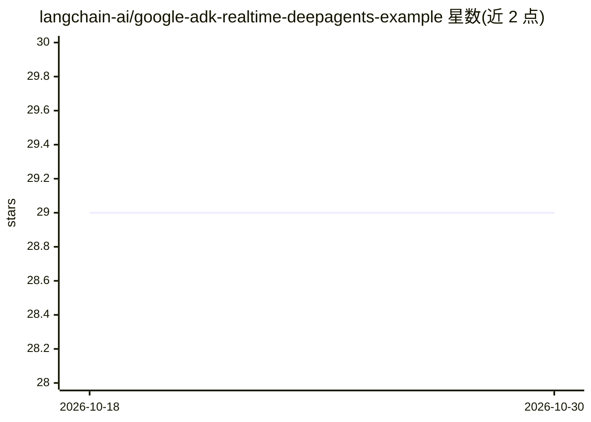

# langchain-ai/google-adk-realtime-deepagents-example

⭐ 29 · Python · 推送 2026-06-29 · [GitHub](https://github.com/langchain-ai/google-adk-realtime-deepagents-example) · 组织维护

**Google ADK + Gemini Live + deepagents 的实时语音研究 agent 示例**

langchain-ai 维护的演示项目：FastAPI WebSocket 桥接浏览器麦克风与 ADK 运行的 Gemini Live 双向语音会话，支持打断；需要深入研究的提问会被委派给 deepagents 工具，由其规划、执行多次 Tavily 搜索并生成报告，再由语音模型口语化播报。每次研究会话以嵌套树形式记录到 LangSmith，可回放各规划步骤与子 agent 调用。使用 uv sync 或 pip install -e . 安装，需 Google 与 Tavily API key。README 声明这是本地演示，WebSocket 无鉴权、会话存于内存，公开部署前需自行加鉴权、TLS 与会话存储。

## 筛选速览

| 维度 | 判定 | 备注 |
|---|---|---|
| AI 角色 | `ai-native` | 本体是模型或模型工具 |
| 许可风险 | `none` | — |
| 部署形态 | `library` | 以包/库形式分发 |
| 模型依赖 | — | README 未给出锁定关系 |
| 硬件要求 | — | 无带数字的原话,不猜 |
| 安装摩擦 | `low` | 无编译、无系统依赖或容器化 |
| 成熟度 | — | 结构信号不足 |

## 能力要点

- Gemini Live 双向语音会话，支持 barge-in 打断
- deepagents 规划多次 Tavily 搜索并生成研究报告
- 整个会话以单一嵌套树 trace 到 LangSmith
- 可通过环境变量更换语音模型与研究模型（含 Claude）

## 适用场景

- 参考搭建自己的实时语音研究助手
- 学习 ADK live 会话与 deepagents 工具集成的接法
- 验证 LangSmith 对语音会话与深度研究的统一追踪

## 场景标签

`语音 Agent` · 领域:对话与助手

## 证据(README 行号)

> L3: A small, hackable demo of a **real-time voice agent**:
> L5: - **Google ADK** runs a bidirectional **Gemini Live API** session (`gemini-3.1-flash-live-preview`) — you talk, it t
> L6: - When you ask something that needs real research, the voice agent calls a **LangChain deepagents** tool that plans,

## 星数曲线

2026-10-18 29 → 2026-10-30 29（+0）

---
*卡片 v1 · prompt 1.4 · 生成 2026-10-26 · 置信度 high · 依据 README sha `d0d0006150e5` · [字段定义](../../DATASET.md)*
