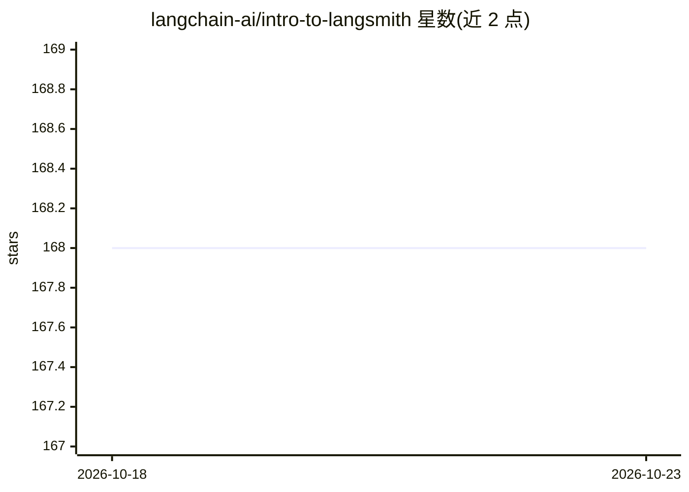

# langchain-ai/intro-to-langsmith

⭐ 168 · Jupyter Notebook · MIT · 推送 2026-09-25 · [GitHub](https://github.com/langchain-ai/intro-to-langsmith) · 组织维护

**LangSmith 入门课程配套代码仓库（教程资源）**

LangChain Academy 的 Introduction to LangSmith 课程配套仓库，以五个模块的 Jupyter Notebook 讲授 LangSmith 的观测追踪、数据集与评测实验、Prompt 工程、人工反馈收集与生产监控。提供 git clone 获取、uv 或 pip 建立虚拟环境安装依赖的流程，附带 env_utils.py 环境校验脚本。课程需 LangSmith 与 OpenAI 的 API key，主要使用 gpt-4o 与 gpt-4o-mini，可换用其他 provider 但需改代码；LangSmith 追踪为可选功能。

## 筛选速览

| 维度 | 判定 | 备注 |
|---|---|---|
| AI 角色 | `ai-knowledge` | 知识聚合/清单类 |
| 许可风险 | `permissive` | MIT |
| 部署形态 | `library` | 以包/库形式分发 |
| 模型依赖 | — | README 未给出锁定关系 |
| 硬件要求 | — | 无带数字的原话,不猜 |
| 安装摩擦 | `low` | 无编译、无系统依赖或容器化 |
| 成熟度 | — | 结构信号不足 |

## 能力要点

- 五个模块覆盖追踪、评测、Prompt 工程、人工反馈与生产监控
- uv（推荐）或 pip 两种安装与环境管理流程
- env_utils.py 环境校验脚本检查 Python 版本、依赖与 API key 配置
- 支持 LangSmith 自托管与 EU 实例的端点配置

## 适用场景

- 跟着课程学习 LangSmith 的可观测性与评测功能
- 在本地 Jupyter 环境中运行课程 Notebook
- 了解 LangSmith 追踪、反馈与监控的接入方式

## 场景标签

`教程课程` · 领域:学习与行业

## 证据(README 行号)

> L5: Welcome to LangChain Academy's **Introduction to LangSmith** course!
> L9: In this course, we will walk through the fundamentals of LangSmith - exploring observability, prompt engineering, ev

## 星数曲线

2026-10-18 168 → 2026-10-23 168（+0）

---
*卡片 v1 · prompt 1.4 · 生成 2026-10-22 · 置信度 high · 依据 README sha `aeb99d155dc6` · [字段定义](../../DATASET.md)*
