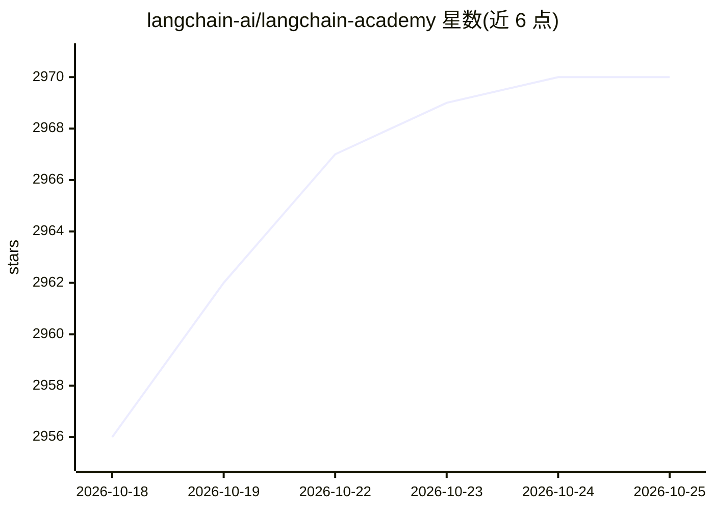

# langchain-ai/langchain-academy

⭐ 2,970 · Jupyter Notebook · MIT · 推送 2026-06-15 · [GitHub](https://github.com/langchain-ai/langchain-academy) · [官网](https://academy.langchain.com) · 组织维护

**LangGraph 官方教学课程仓库：7 个模块的入门与部署教程**

LangChain 官方学院的教学代码仓库，以 Jupyter notebook 形式提供 LangGraph 入门课程：Module 0 为环境搭建，Module 1-5 逐步讲解 LangGraph 构建，Module 6 覆盖 agent 部署。每个模块附 studio 子目录，可用 LangGraph API 与 Studio（通过 langgraph dev 本地服务器）查看和测试图。需配置 OpenAI、LangSmith、Tavily 等 API key，部分课程（Module 4）使用 Tavily 网络搜索。仅支持 Python 3.11-3.13。

## 筛选速览

| 维度 | 判定 | 备注 |
|---|---|---|
| AI 角色 | `ai-knowledge` | 知识聚合/清单类 |
| 许可风险 | `permissive` | MIT |
| 部署形态 | `library` | 以包/库形式分发 |
| 模型依赖 | — | README 未给出锁定关系 |
| 硬件要求 | — | 无带数字的原话,不猜 |
| 安装摩擦 | `low` | 无编译、无系统依赖或容器化 |
| 成熟度 | — | 结构信号不足 |

## 能力要点

- 7 个递进模块覆盖 LangGraph 基础到 agent 部署
- 每模块含 studio 子目录，可经 LangGraph API 与 Studio 测试图
- 提供 Mac/Linux/WSL 与 Windows PowerShell 两套环境搭建步骤
- 集成 LangSmith 追踪与 Tavily 搜索 API

## 适用场景

- 跟学 LangGraph 的基础概念与构建方式
- 在 Studio 中本地查看和测试教学示例图
- 了解 LangGraph agent 的部署流程

## 场景标签

`教程课程` · 领域:学习与行业

## 证据(README 行号)

> L5: Welcome to LangChain Academy, Introduction to LangGraph!
> L7: Module 0 is basic setup and Modules 1 - 5 focus on building in LangGraph, progressively adding more advanced themes.

## 星数曲线

2026-10-18 2,956 → 2026-10-25 2,970（+14）

---
*卡片 v1 · prompt 1.4 · 生成 2026-10-20 · 置信度 mid · 依据 README sha `5d97a0c190e8` · [字段定义](../../DATASET.md)*
