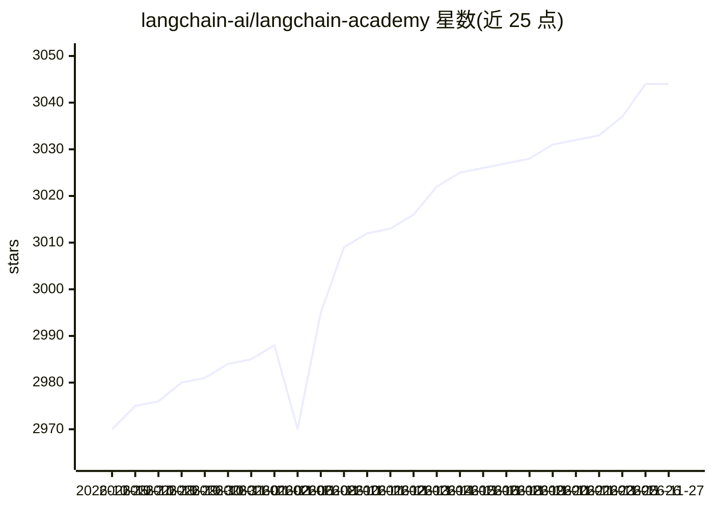

# langchain-ai/langchain-academy

⭐ 3,044 · Jupyter Notebook · MIT · 推送 2026-11-24 · [GitHub](https://github.com/langchain-ai/langchain-academy) · [官网](https://academy.langchain.com) · 组织维护

**面向开发者的 LangGraph 基础概念课程配套 notebook 仓库**

LangChain 官方学院推出的「Introduction to LangGraph」课程配套代码库，按模块组织 notebook：模块 0 为环境配置，模块 1–5 递进讲解 LangGraph 构建主题，模块 6 涵盖 agent 部署。每个 notebook 顶部附课程链接，各模块含 studio 子目录，可配合 LangGraph API 与 Studio 本地开发服务器（langgraph dev）查看和测试图。运行需 Python 3.11–3.13、venv 环境、Jupyter，以及 OpenAI、LangSmith、Tavily 的 API key。

## 筛选速览

| 维度 | 判定 | 备注 |
|---|---|---|
| AI 角色 | `ai-knowledge` | 知识聚合/清单类 |
| 许可风险 | `permissive` | MIT |
| 部署形态 | `library` | 以包/库形式分发 |
| 模型依赖 | — | README 未给出锁定关系 |
| 硬件要求 | — | 无带数字的原话,不猜 |
| 安装摩擦 | `low` | 无编译、无系统依赖或容器化 |
| 成熟度 | — | 结构信号不足 |

## 能力要点

- 6 个模块递进覆盖 LangGraph 基础到 agent 部署
- 每模块含 studio 子目录的图，可用本地 Studio 服务器查看
- 支持通过 LangSmith LLM Gateway 路由 ChatOpenAI 调用
- 提供 Mac/Linux/WSL 与 Windows 两套环境配置说明

## 适用场景

- 系统学习 LangGraph 的状态图与 agent 构建
- 在本地 Studio 中查看和调试课程中的图
- 准备 LangGraph agent 的部署（模块 6）

## 场景标签

`教程课程` · 领域:学习与行业

## 证据(README 行号)

> L6: This is a growing set of modules focused on foundational concepts within the LangChain ecosystem.
> L7: Module 0 is basic setup and Modules 1 - 5 focus on building in LangGraph, progressively adding more advanced themes.
> L8: In each module folder, you'll see a set of notebooks. A link to the LangChain Academy lesson is at the top of each n

## 星数曲线

2026-10-25 2,970 → 2026-11-27 3,044（+74）

---
*卡片 v1 · prompt 1.4 · 生成 2026-11-26 · 置信度 high · 依据 README sha `469df885c20f` · [字段定义](../../DATASET.md)*
