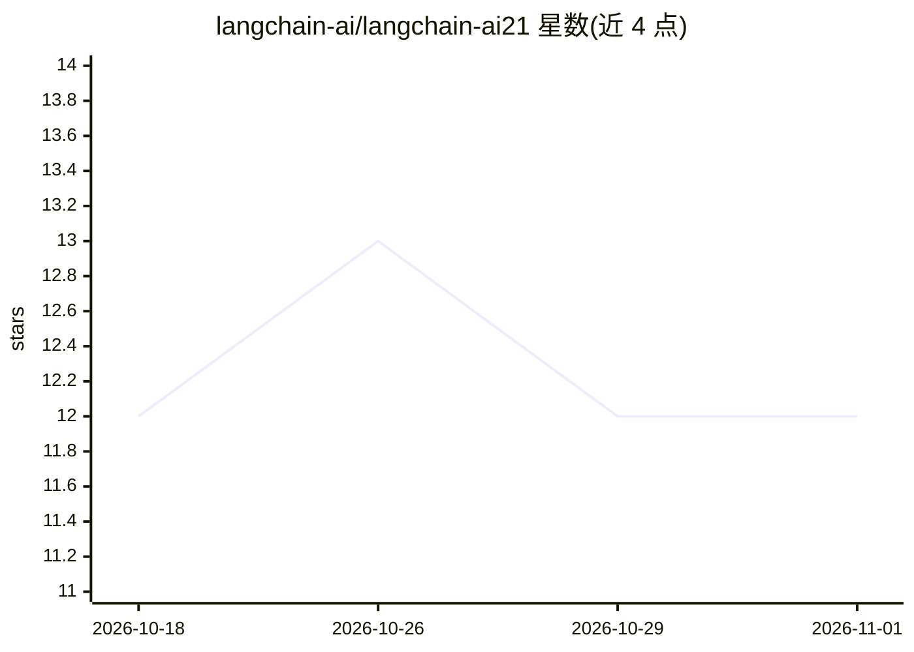

# langchain-ai/langchain-ai21

⭐ 12 · Python · MIT · 推送 2026-10-26 · [GitHub](https://github.com/langchain-ai/langchain-ai21) · 组织维护

**LangChain 官方的 AI21 模型接入集成包**

langchain-ai 机构维护的仓库，包含一个 Python 包 langchain-ai21，将 AI21 的模型能力以 LangChain 集成形式提供，供已在 LangChain 生态中构建应用的开发者接入 AI21 API 使用。README 仅说明仓库包含该集成包，未展示具体组件列表、安装命令或使用示例，更多细节需查阅包文档或源码。

## 筛选速览

| 维度 | 判定 | 备注 |
|---|---|---|
| AI 角色 | `ai-ecosystem` | LLM/agent 周边工具 |
| 许可风险 | `permissive` | MIT |
| 部署形态 | `None` |  |
| 模型依赖 | — | README 未给出锁定关系 |
| 硬件要求 | — | 无带数字的原话,不猜 |
| 安装摩擦 | `low` | 无编译、无系统依赖或容器化 |
| 成熟度 | — | 结构信号不足 |

## 能力要点

- 提供 AI21 与 LangChain 的集成（单一包 langchain-ai21）
- 由 langchain-ai 机构维护

## 适用场景

- 在 LangChain 应用中调用 AI21 的模型
- 为现有 LangChain 工程添加 AI21 作为模型提供方

## 场景标签

 · 领域:LLM 集成/框架生态

## 证据(README 行号)

> L3: This repository contains 1 package with AI21 integrations with LangChain:

## 星数曲线

2026-10-18 12 → 2026-11-01 12（+0）

---
*卡片 v1 · prompt 1.4 · 生成 2026-11-01 · 置信度 mid · 依据 README sha `d4e083302393` · [字段定义](../../DATASET.md)*
