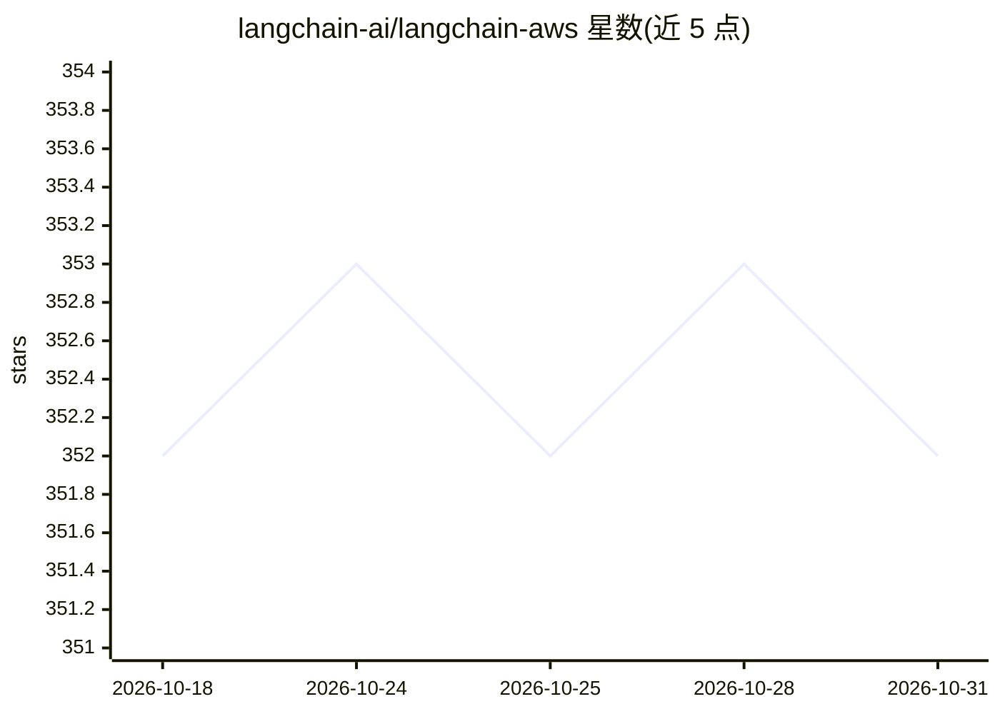

# langchain-ai/langchain-aws

⭐ 352 · Python · MIT · 推送 2026-10-29 · [GitHub](https://github.com/langchain-ai/langchain-aws) · 组织维护

**为 LangChain/LangGraph 提供 AWS 服务集成组件的 Python 库**

LangChain 官方团队维护的 monorepo，发布三个 PyPI 包：langchain-aws、langgraph-checkpoint-aws、langchain-agentcore-codeinterpreter。提供接入 AWS Bedrock 与 SageMaker 的 LLM 类、MemoryDB/S3 Vectors/ElastiCache 等向量存储、Kendra 与 Bedrock KnowledgeBases 检索器、Neptune 图组件、Bedrock Agents 运行件、LangGraph 的 DynamoDB/ElastiCache 检查点与记忆存储，以及 Bedrock AgentCore 代码解释器沙盒后端。声明将取代 langchain-community 中的 AWS 集成并建议用户迁移。

## 筛选速览

| 维度 | 判定 | 备注 |
|---|---|---|
| AI 角色 | `ai-ecosystem` | LLM/agent 周边工具 |
| 许可风险 | `permissive` | MIT |
| 部署形态 | `library` | 以包/库形式分发 |
| 模型依赖 | locked-api |  |
| 硬件要求 | — | 无带数字的原话,不猜 |
| 安装摩擦 | `low` | 无编译、无系统依赖或容器化 |
| 成熟度 | — | 结构信号不足 |

## 能力要点

- Bedrock 与 SageMaker Endpoint 的 LLM 类接入
- 多种 AWS 向量存储与检索器（Kendra/Bedrock KnowledgeBases 等）
- LangGraph checkpointers 与 memory stores（DynamoDB、ElastiCache 等）
- Bedrock AgentCore 代码解释器沙盒后端

## 适用场景

- 在 LangChain 应用中调用 Bedrock 或 SageMaker 模型
- 为 LangGraph agent 配置 AWS 服务的检查点与长期记忆
- 使用 Bedrock AgentCore 工具与代码执行沙盒构建 agent

## 场景标签

`Agent 记忆` · 领域:Agent 开发

## 证据(README 行号)

> L3: This monorepo provides LangChain and LangGraph components for various AWS services. It aims to replace and expand up
> L15: - **LLMs**: Includes LLM classes for AWS services like Bedrock and SageMaker Endpoints, allowing you to leverage th

## 星数曲线

2026-10-18 352 → 2026-10-31 352（+0）

---
*卡片 v1 · prompt 1.4 · 生成 2026-10-21 · 置信度 high · 依据 README sha `bce97a75f354` · [字段定义](../../DATASET.md)*
