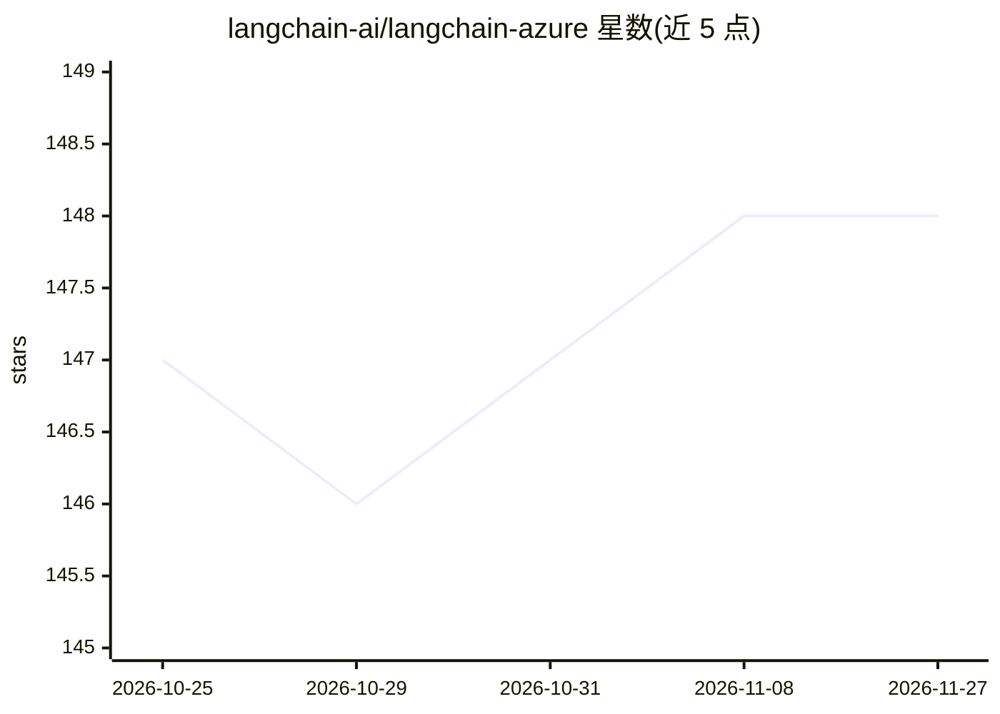

# langchain-ai/langchain-azure

⭐ 148 · Jupyter Notebook · MIT · 推送 2026-11-26 · [GitHub](https://github.com/langchain-ai/langchain-azure) · 组织维护

**为 LangChain/LangGraph 开发者提供 Azure 服务集成包集合**

该仓库包含 langchain-azure-ai、langchain-azure-cosmosdb、langchain-sqlserver 等 8 个包，将 Azure 服务接入 LangChain 与 LangGraph，并声明将逐步取代 langchain-community 中现有的 Azure 集成。核心包 langchain-azure-ai 基于 Microsoft Foundry SDK，提供 Foundry Models 推理、Agent Service、Content Safety、Azure AI Search 等能力；支持 OpenAI 兼容 API、Entra ID 或 API key 认证、LangGraph 持久化检查点与托管 Agent 部署。以 pip 包形式分发，面向在 Azure 上构建 LangChain 应用的开发者。

## 筛选速览

| 维度 | 判定 | 备注 |
|---|---|---|
| AI 角色 | `ai-ecosystem` | LLM/agent 周边工具 |
| 许可风险 | `permissive` | MIT |
| 部署形态 | `library` | 以包/库形式分发 |
| 模型依赖 | locked-api |  |
| 硬件要求 | — | 无带数字的原话,不猜 |
| 安装摩擦 | `low` | 无编译、无系统依赖或容器化 |
| 成熟度 | — | 结构信号不足 |

## 能力要点

- 8 个包覆盖 Azure AI、数据库、存储、计算等集成
- langchain-azure-ai 支持 OpenAI 兼容 API、Anthropic Messages API 与 Decision 模型
- 支持 Entra ID（az login）与 API key 两种认证方式
- 提供 Foundry CheckpointSaver / Cosmos DB 检查点与 LangGraph 托管部署样例

## 适用场景

- 在 LangChain/LangGraph 中调用 Microsoft Foundry 模型
- 为 LangGraph Agent 添加持久化状态与长期记忆存储
- 将 LangGraph 应用部署到 Microsoft Foundry 托管环境

## 场景标签

`Agent 记忆` · 领域:Agent 开发

## 证据(README 行号)

> L3: This repository contains the following packages with Azure integrations with LangChain:
> L31: The `langchain-azure-ai` package uses the Microsoft Foundry family of SDKs and client libraries for Azure to provid

## 星数曲线

2026-10-25 147 → 2026-11-27 148（+1）

---
*卡片 v1 · prompt 1.4 · 生成 2026-11-27 · 置信度 high · 依据 README sha `c4dcd3924916` · [字段定义](../../DATASET.md)*
