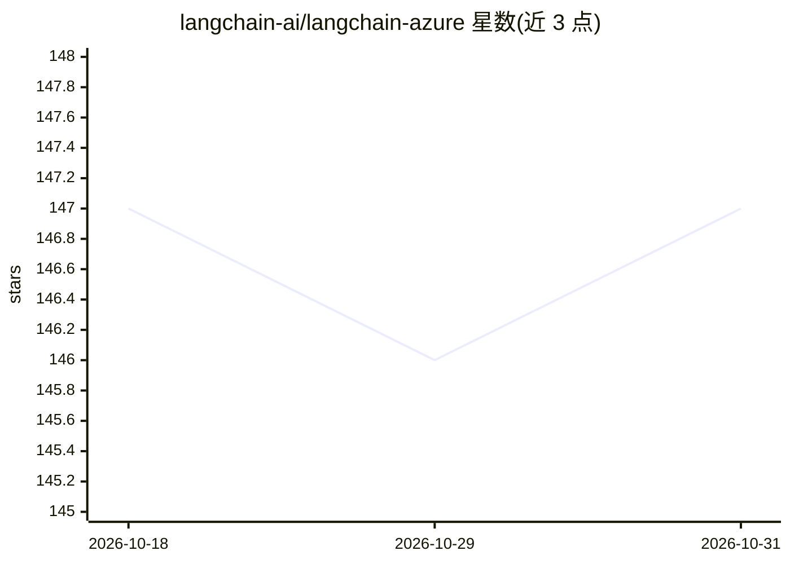

# langchain-ai/langchain-azure

⭐ 147 · Jupyter Notebook · MIT · 推送 2026-10-30 · [GitHub](https://github.com/langchain-ai/langchain-azure) · 组织维护

**LangChain 的 Azure 集成包集合：接入微软 Foundry 模型与 Azure 服务**

langchain-ai 组织维护的 Azure 集成仓库，含 7 个包：langchain-azure-ai（Microsoft Foundry 模型推理、Agent Service、Content Safety、Azure AI Search 等）、compute、cosmosdb、dynamic-sessions、sqlserver、postgresql、storage。官方声明将替换 langchain-community 中的全部 Azure 集成并建议用户迁移。面向在 LangChain/LangGraph 应用中使用 Azure 的开发者，提供 LangGraph 托管与 FoundryCheckpointSaver 持久化状态等机制。

## 筛选速览

| 维度 | 判定 | 备注 |
|---|---|---|
| AI 角色 | `ai-ecosystem` | LLM/agent 周边工具 |
| 许可风险 | `permissive` | MIT |
| 部署形态 | `library` | 以包/库形式分发 |
| 模型依赖 | — | README 未给出锁定关系 |
| 硬件要求 | — | 无带数字的原话,不猜 |
| 安装摩擦 | `low` | 无编译、无系统依赖或容器化 |
| 成熟度 | — | 结构信号不足 |

## 能力要点

- 7 个 Azure 集成包（Foundry/ Cosmos DB/ SQL Server/ PostgreSQL/存储等）
- langchain-azure-ai 通过微软 Foundry SDK 提供模型推理与 Agent Service 集成
- 将替换 langchain-community 中的 Azure 集成
- LangGraph 托管指南与 Cosmos DB 检查点/长期记忆存储

## 适用场景

- 在 LangChain 应用中调用 Microsoft Foundry 模型推理
- 用 LangGraph 组合 Foundry Agent Service 构建多智能体图
- 将 LangGraph 图部署到 Microsoft Foundry 并持久化状态

## 场景标签

`Agent 记忆` · 领域:Agent 开发

## 证据(README 行号)

> L3: This repository contains the following packages with Azure integrations with LangChain:
> L23: The `langchain-azure-ai` package uses the Microsoft Foundry family of SDKs and client libraries for Azure to provid

## 星数曲线

2026-10-18 147 → 2026-10-31 147（+0）

---
*卡片 v1 · prompt 1.4 · 生成 2026-10-22 · 置信度 high · 依据 README sha `a89e93d4f65c` · [字段定义](../../DATASET.md)*
