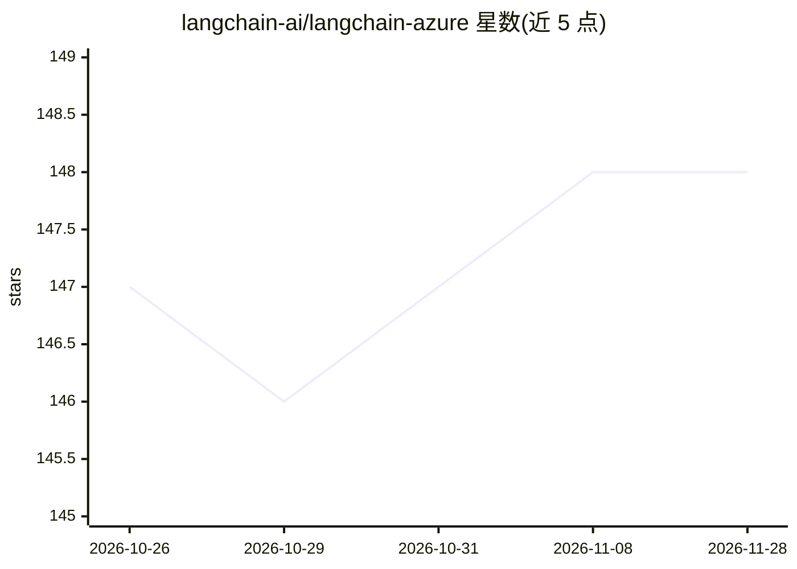

# langchain-ai/langchain-azure

⭐ 148 · Jupyter Notebook · MIT · 推送 2026-11-27 · [GitHub](https://github.com/langchain-ai/langchain-azure) · 组织维护

**给 LangChain/LangGraph 用户提供 Azure 服务集成包集合**

langchain-ai 维护的 Azure 集成仓库，包含 langchain-azure-ai、cosmosdb、postgresql、storage、sqlserver 等 8 个包，用于在 LangChain/LangGraph 中接入 Microsoft Foundry 模型推理、Agent Service、Content Safety、Azure AI Search 及数据/存储服务。计划逐步替换 langchain-community 中的 Azure 集成。提供 LangGraph on Azure 托管与持久化方案（FoundryCheckpointSaver、Cosmos DB checkpointer），SDK 示例与 notebook 覆盖托管、记忆、存储场景。包通过 pip 安装。

## 筛选速览

| 维度 | 判定 | 备注 |
|---|---|---|
| AI 角色 | `ai-ecosystem` | LLM/agent 周边工具 |
| 许可风险 | `permissive` | MIT |
| 部署形态 | `library` | 以包/库形式分发 |
| 模型依赖 | locked-api |  |
| 硬件要求 | — | 无带数字的原话,不猜 |
| 安装摩擦 | `low` | 无编译、无系统依赖或容器化 |
| 成熟度 | — | 结构信号不足 |

## 能力要点

- 8 个 Azure 集成包：AI、Compute、Cosmos DB、动态会话、SQL Server、PostgreSQL、Storage 等
- Foundry Models 经 OpenAI 兼容 API 接入，支持 Responses API 与 Chat Completions 两种方式
- Foundry Agent Service 节点可嵌入 LangGraph 图，支持持久化执行与故障隔离
- 声明将替换 langchain-community 中全部 Azure 集成

## 适用场景

- 在 LangChain 应用中调用 Microsoft Foundry 上的模型推理
- 为 LangGraph agent 配置 Azure 上的托管与持久化状态
- 在 LangChain 中接入 Cosmos DB、SQL Server、PostgreSQL 等数据服务

## 场景标签

 · 领域:LLM 基础设施/云服务集成

## 证据(README 行号)

> L3: This repository contains the following packages with Azure integrations with LangChain:
> L31: The `langchain-azure-ai` package uses the Microsoft Foundry family of SDKs and client libraries for Azure to provid

## 星数曲线

2026-10-26 147 → 2026-11-28 148（+1）

---
*卡片 v1 · prompt 1.4 · 生成 2026-11-28 · 置信度 high · 依据 README sha `537cb52fee24` · [字段定义](../../DATASET.md)*
