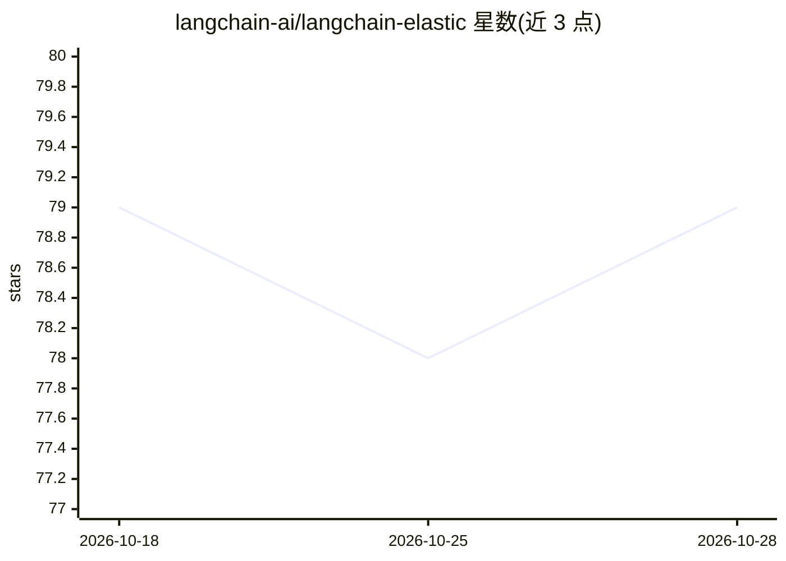

# langchain-ai/langchain-elastic

⭐ 79 · Python · MIT · 推送 2026-10-23 · [GitHub](https://github.com/langchain-ai/langchain-elastic) · 组织维护

**LangChain 的 Elasticsearch 集成包：检索、向量存储、缓存等**

由 langchain-ai 组织维护的集成仓库，包含 1 个包 langchain-elasticsearch，将 Elasticsearch 能力接入 LangChain：提供 ElasticsearchStore 向量存储、ElasticsearchRetriever 检索器、ElasticsearchEmbeddings 嵌入、聊天消息历史与两层缓存（LLM 缓存、嵌入缓存）组件，供开发者在 LangChain 应用中使用 Elasticsearch 作为存储与检索后端。

## 筛选速览

| 维度 | 判定 | 备注 |
|---|---|---|
| AI 角色 | `ai-ecosystem` | LLM/agent 周边工具 |
| 许可风险 | `permissive` | MIT |
| 部署形态 | `None` |  |
| 模型依赖 | — | README 未给出锁定关系 |
| 硬件要求 | — | 无带数字的原话,不猜 |
| 安装摩擦 | `low` | 无编译、无系统依赖或容器化 |
| 成熟度 | — | 结构信号不足 |

## 能力要点

- ElasticsearchStore 向量存储与 ElasticsearchRetriever 检索器
- ElasticsearchEmbeddings 嵌入组件
- 聊天消息历史与 LLM/嵌入缓存组件

## 适用场景

- 在 LangChain 应用中使用 Elasticsearch 做向量检索
- 将对话历史或 LLM 响应缓存到 Elasticsearch

## 场景标签

`向量数据库` · 领域:知识与检索

## 证据(README 行号)

> L3: This repository contains 1 package with Elasticsearch integrations with LangChain:
> L5: - langchain-elasticsearch integrates Elasticsearch.

## 星数曲线

2026-10-18 79 → 2026-10-28 79（+0）

---
*卡片 v1 · prompt 1.4 · 生成 2026-10-24 · 置信度 high · 依据 README sha `da308dd50aea` · [字段定义](../../DATASET.md)*
