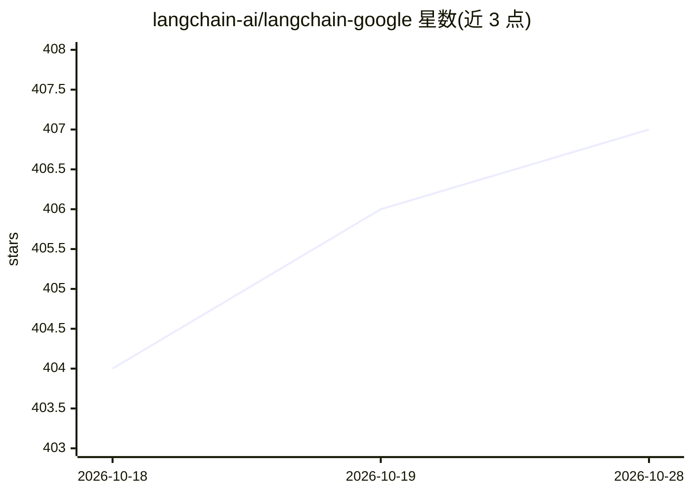

# langchain-ai/langchain-google

⭐ 407 · Python · MIT · 推送 2026-10-26 · [GitHub](https://github.com/langchain-ai/langchain-google) · [官网](https://docs.langchain.com/oss/python/integrations/providers/google) · 组织维护

**LangChain 与 Google AI 产品（Gemini/Vertex AI）的集成包集合**

langchain-ai 团队维护的 monorepo，集中提供 LangChain 对 Google AI 产品的接入：langchain-google-genai 封装 Google Generative AI（Gemini API）模型，langchain-google-vertexai 封装 Google Cloud Vertex AI 上的生成式 AI，langchain-google-community 覆盖前两者之外的 Google 产品集成。README 未给出具体安装命令，指向 LangChain 官方文档与 API 参考获取用法与示例。

## 筛选速览

| 维度 | 判定 | 备注 |
|---|---|---|
| AI 角色 | `ai-ecosystem` | LLM/agent 周边工具 |
| 许可风险 | `permissive` | MIT |
| 部署形态 | `None` |  |
| 模型依赖 | — | README 未给出锁定关系 |
| 硬件要求 | — | 无带数字的原话,不猜 |
| 安装摩擦 | `low` | 无编译、无系统依赖或容器化 |
| 成熟度 | — | 结构信号不足 |

## 能力要点

- langchain-google-genai：Gemini API 模型集成
- langchain-google-vertexai：Vertex AI 生成式 AI 集成
- langchain-google-community：其他 Google 产品集成

## 适用场景

- 在 LangChain 应用中调用 Gemini API 模型
- 通过 Vertex AI 使用 Google Cloud 生成式 AI
- 查找 LangChain 对 Google 系产品的接入支持

## 场景标签

`模型网关` · 领域:Agent 开发

## 证据(README 行号)

> L3: This repository centralizes Google integrations for LangChain projects.
> L7: - `langchain-google-genai` implements integrations of Google Generative AI (Gemini API) models.

## 星数曲线

2026-10-18 404 → 2026-10-28 407（+3）

---
*卡片 v1 · prompt 1.4 · 生成 2026-10-21 · 置信度 high · 依据 README sha `6ea7673c157e` · [字段定义](../../DATASET.md)*
