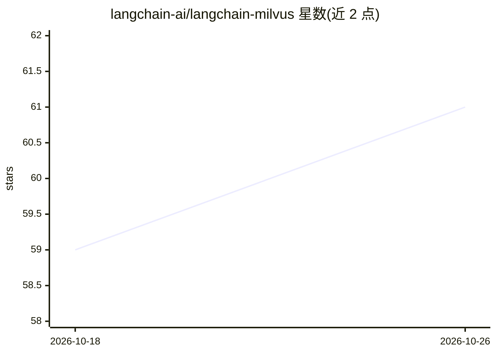

# langchain-ai/langchain-milvus

⭐ 61 · Python · MIT · 推送 2026-10-25 · [GitHub](https://github.com/langchain-ai/langchain-milvus) · [官网](https://milvus.io/docs/integrate_with_langchain.md) · 组织维护

**LangChain 与 Milvus 向量数据库的集成包，支持向量检索与 RAG**

langchain-ai 维护的集成包，将 Milvus 向量数据库接入 LangChain：提供向量存储（存储任意 LangChain 嵌入模型产生的向量）、相似度检索、混合检索（向量+关键词）、全文检索、MMR 多样性过滤、多向量字段与稀疏嵌入支持，并可调用 Milvus 内置函数（如 BM25）。面向使用 LangChain 构建 RAG、语义搜索、推荐系统等应用的开发者，以 Python 包形式经 pip 安装，MIT 许可。

## 筛选速览

| 维度 | 判定 | 备注 |
|---|---|---|
| AI 角色 | `ai-ecosystem` | LLM/agent 周边工具 |
| 许可风险 | `permissive` | MIT |
| 部署形态 | `library` | 以包/库形式分发 |
| 模型依赖 | — | README 未给出锁定关系 |
| 硬件要求 | — | 无带数字的原话,不猜 |
| 安装摩擦 | `low` | 无编译、无系统依赖或容器化 |
| 成熟度 | — | 结构信号不足 |

## 能力要点

- 向量存储与相似度检索，兼容任意 LangChain 嵌入模型
- 混合检索（向量+关键词）与全文检索
- 支持多向量字段、稀疏嵌入与 Milvus 内置函数（如 BM25）
- 完整支持异步操作与 API

## 适用场景

- 用 LangChain 构建以 Milvus 为后端的 RAG 应用
- 实现语义搜索或推荐系统的向量存取
- 需要向量与关键词混合检索的场景

## 场景标签

`RAG` · 领域:知识与检索

## 证据(README 行号)

> L7: This repository contains the Milvus integration package for LangChain:
> L13: LangChain Milvus provides seamless integration between LangChain, a framework for building applications with large 

## 星数曲线

2026-10-18 59 → 2026-10-26 61（+2）

---
*卡片 v1 · prompt 1.4 · 生成 2026-10-24 · 置信度 high · 依据 README sha `453369803c0a` · [字段定义](../../DATASET.md)*
