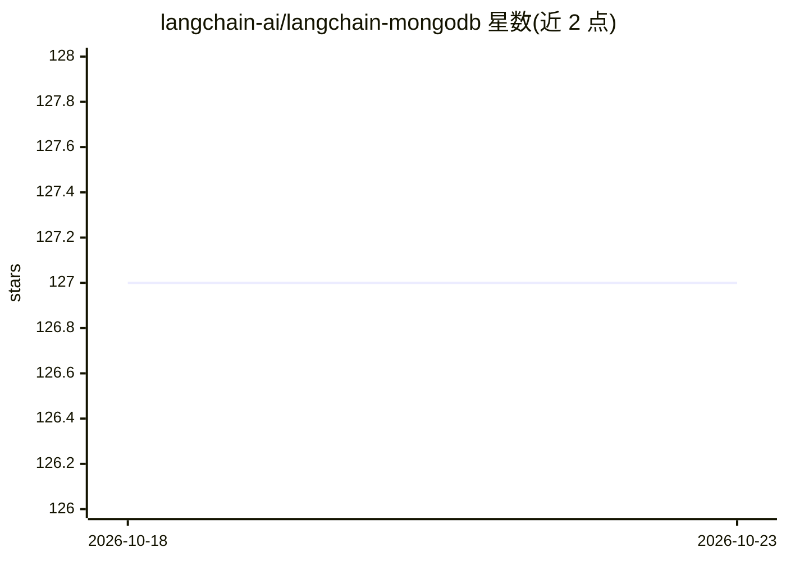

# langchain-ai/langchain-mongodb

⭐ 127 · Python · MIT · 推送 2026-10-22 · [GitHub](https://github.com/langchain-ai/langchain-mongodb) · [官网](https://docs.langchain.com/oss/python/integrations/providers/mongodb_atlas) · 组织维护

**MongoDB 与 LangChain/LangGraph 的官方集成包集合**

Monorepo 形式提供 MongoDB 与 LangChainAI 的伙伴包：langchain-mongodb、langgraph-checkpoint-mongodb、langgraph-store-mongodb 三个 PyPI 包。功能包括 Atlas 全文/混合/向量检索 Retriever、语义缓存、聊天历史、文档加载器，以及 LangGraph 的 Checkpointing（MongoDBSaver）与长期记忆存储（MongoDBStore）。该仓库取代 langchain-community 中的 MongoDB 集成，建议用户迁移。MIT 许可。

## 筛选速览

| 维度 | 判定 | 备注 |
|---|---|---|
| AI 角色 | `ai-ecosystem` | LLM/agent 周边工具 |
| 许可风险 | `permissive` | MIT |
| 部署形态 | `library` | 以包/库形式分发 |
| 模型依赖 | — | README 未给出锁定关系 |
| 硬件要求 | — | 无带数字的原话,不猜 |
| 安装摩擦 | `low` | 无编译、无系统依赖或容器化 |
| 成熟度 | — | 结构信号不足 |

## 能力要点

- Atlas 向量/全文/混合搜索 Retriever 与语义缓存
- LangGraph 检查点保存（MongoDBSaver）与长期记忆存储（MongoDBStore）
- 取代 langchain-community 中的 MongoDB 集成

## 适用场景

- 在 LangChain 应用中用 Atlas 做向量检索与语义缓存
- 为 LangGraph 工作流持久化检查点与长期记忆
- 统一迁移社区包中的 MongoDB 集成到官方维护包

## 场景标签

`RAG` `Agent 记忆` · 领域:Agent 开发

## 证据(README 行号)

> L3: This is a Monorepo containing partner packages of MongoDB and LangChainAI.
> L4: It includes integrations between MongoDB, Atlas, LangChain, and LangGraph.

## 星数曲线

2026-10-18 127 → 2026-10-23 127（+0）

---
*卡片 v1 · prompt 1.4 · 生成 2026-10-23 · 置信度 high · 依据 README sha `95a69192831d` · [字段定义](../../DATASET.md)*
