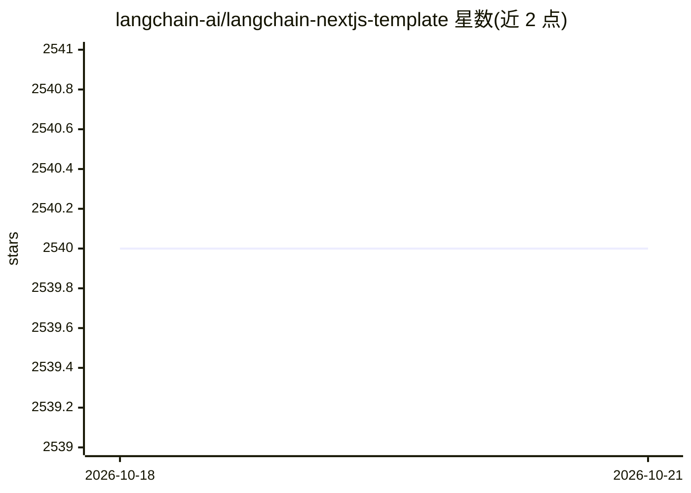

# langchain-ai/langchain-nextjs-template

⭐ 2,540 · TypeScript · MIT · 推送 2026-10-19 · [GitHub](https://github.com/langchain-ai/langchain-nextjs-template) · [官网](https://langchain-nextjs-template.vercel.app) · 组织维护

**LangChain.js + Next.js 起步模板：演示聊天/RAG/Agent 等用例**

LangChain 官方维护的 Next.js 起步应用模板，展示如何组合 LangChain 模块实现简单聊天、结构化输出、Agent 多步问答、基于 chain 与 Agent 的两种 RAG 用例。Agent 部分使用 LangGraph.js，令牌流式输出使用 Vercel AI SDK。默认接 OpenAI API key 运行基础示例，RAG 用 Supabase 作向量库，Tavily 提供搜索。应用按 serverless Edge 函数设计，附托管演示与集成测试，通过 git clone 后 yarn 安装运行。

## 筛选速览

| 维度 | 判定 | 备注 |
|---|---|---|
| AI 角色 | `ai-ecosystem` | LLM/agent 周边工具 |
| 许可风险 | `permissive` | MIT |
| 部署形态 | `None` |  |
| 模型依赖 | — | README 未给出锁定关系 |
| 硬件要求 | — | 无带数字的原话,不猜 |
| 安装摩擦 | `low` | 无编译、无系统依赖或容器化 |
| 成熟度 | — | 结构信号不足 |

## 能力要点

- 覆盖聊天、结构化输出、Agent、两种 RAG 共 5 类示例
- Agent 基于 LangGraph.js，流式输出使用 Vercel AI SDK
- 默认以 Supabase 为向量库，可替换其他受支持的向量库
- 面向 Vercel 免费层设计，附 bundle 体积统计与集成测试

## 适用场景

- 基于此模板快速搭建 LLM 聊天或 RAG 应用
- 学习 LangChain.js 各模块在 Next.js 中的组合方式
- 部署到 Vercel 的 serverless Edge 环境运行

## 场景标签

`Agent 框架` `RAG` · 领域:Agent 开发

## 证据(README 行号)

> L6: This template scaffolds a LangChain.js + Next.js starter app. It showcases how to use and combine LangChain modules 
> L17: The agents use LangGraph.js, LangChain's framework for building agentic workflows. They use preconfigured helper fu

## 星数曲线

2026-10-18 2,540 → 2026-10-21 2,540（+0）

---
*卡片 v1 · prompt 1.4 · 生成 2026-10-21 · 置信度 high · 依据 README sha `47e9787dca4a` · [字段定义](../../DATASET.md)*
