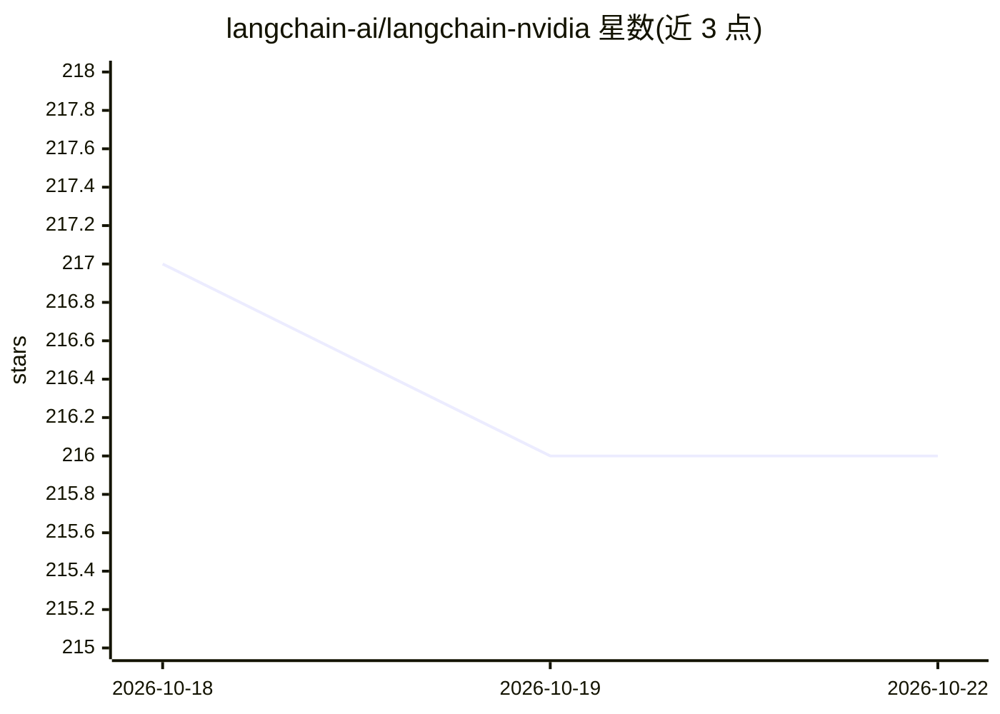

# langchain-ai/langchain-nvidia

⭐ 216 · Jupyter Notebook · MIT · 推送 2026-10-19 · [GitHub](https://github.com/langchain-ai/langchain-nvidia) · 组织维护

**NVIDIA 与 LangChain 集成的官方包合集**

langchain-ai 维护的仓库，包含五个 Python 包：langchain-nvidia-ai-endpoints 接入 NVIDIA AI Foundation Models 与 Endpoints（含 Nemotron 模型家族）；langchain-nvidia-trt 集成 TensorRT 模型；langchain-nvidia-langgraph 提供 NVIDIA 优化的 LangGraph 并行与投机执行策略；langchain-nvidia-openshell 将 OpenShell 沙箱接入 Deep Agents；langchain-nvidia-switchyard 通过 libsy 算法路由模型调用。面向使用 LangChain 生态接入 NVIDIA 模型与运行时的开发者，README 未给出安装命令，附 cookbook 笔记本与可在 LangGraph Studio 中运行的 agentic RAG 示例。

## 筛选速览

| 维度 | 判定 | 备注 |
|---|---|---|
| AI 角色 | `ai-ecosystem` | LLM/agent 周边工具 |
| 许可风险 | `permissive` | MIT |
| 部署形态 | `None` |  |
| 模型依赖 | — | README 未给出锁定关系 |
| 硬件要求 | — | 无带数字的原话,不猜 |
| 安装摩擦 | `low` | 无编译、无系统依赖或容器化 |
| 成熟度 | — | 结构信号不足 |

## 能力要点

- langchain-nvidia-ai-endpoints 接入 NVIDIA AI Foundation Models 与 Nemotron 模型
- langchain-nvidia-trt 集成 NVIDIA TensorRT 模型
- langchain-nvidia-langgraph 提供并行与投机执行策略
- langchain-nvidia-openshell / switchyard 连接 OpenShell 沙箱与 libsy 路由

## 适用场景

- 在 LangChain/LangGraph 应用中调用 NVIDIA 托管的模型端点
- 用 TensorRT 集成运行 NVIDIA 优化模型
- 在 LangGraph Studio 中运行 agentic RAG 示例工作流

## 场景标签

 · 领域:LLM 基础设施/集成库

## 证据(README 行号)

> L5: This repository contains packages with NVIDIA integrations with LangChain:
> L6: - langchain-nvidia-ai-endpoints integrates NVIDIA AI Foundation Models and Endpoints, including Nemotron, NVIDIA's o

## 星数曲线

2026-10-18 217 → 2026-10-22 216（-1）

---
*卡片 v1 · prompt 1.4 · 生成 2026-10-22 · 置信度 high · 依据 README sha `e73542033fc6` · [字段定义](../../DATASET.md)*
