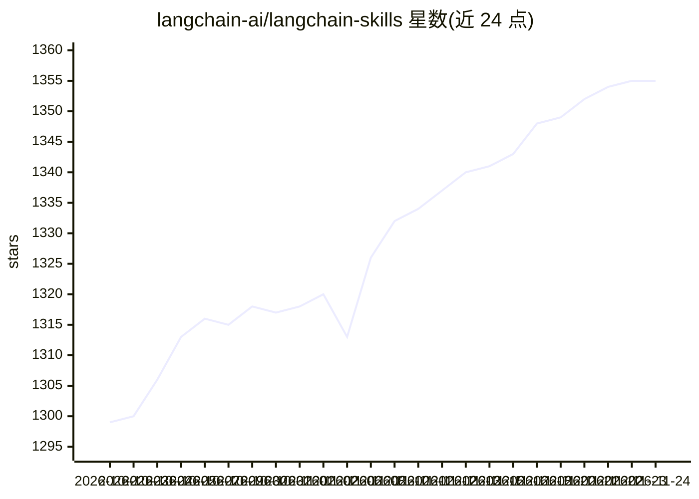

# langchain-ai/langchain-skills

⭐ 1,358 · Python · MIT · 推送 2026-11-24 · [GitHub](https://github.com/langchain-ai/langchain-skills) · 组织维护

**为编码 Agent 提供 LangChain/LangGraph/LangSmith 官方技能包**

由 langchain-ai 维护的技能插件仓库：为构建 Deep Agents、LangGraph、LangChain 应用、以 LangSmith 做评测、以及编写 Harbor 基准提供指导性技能内容，并通过 MCP 连接官方文档与 API 参考。支持 Claude Code、Codex、Deep Agents Code 的插件市场安装，也支持 `npx skills` 独立安装或 clone 后用 install.sh/install.ps1 安装。插件安装不要求模型 API key；运行所构建的应用时才需配置对应模型提供商凭据。项目处于早期开发阶段，API 与技能内容可能变化。

## 筛选速览

| 维度 | 判定 | 备注 |
|---|---|---|
| AI 角色 | `ai-knowledge` | 知识聚合/清单类 |
| 许可风险 | `permissive` | MIT |
| 部署形态 | `library` | 以包/库形式分发 |
| 模型依赖 | — | README 未给出锁定关系 |
| 硬件要求 | — | 无带数字的原话,不猜 |
| 安装摩擦 | `low` | 无编译、无系统依赖或容器化 |
| 成熟度 | `idea` | |

## 能力要点

- 通过插件市场为 Claude Code/Codex/Deep Agents Code 安装，并注册 langchain-docs 与 langchain-reference 两个 MCP 服务器
- 支持 `npx skills` 独立安装、全局/项目级安装及 clone 后脚本安装
- 技能内容覆盖 Deep Agents、LangGraph、LangChain 构建、LangSmith 评测与 Harbor 基准工程
- 附脚本校验技能中引用的 LangSmith CLI 命令与 flag 的有效性

## 适用场景

- 在编码 Agent 中获得 LangChain 官方构建指南与文档检索能力
- 让本地编码 Agent 查询和管理 LangSmith 工作区
- 按项目或全局为多个编码 Agent 批量安装技能

## 场景标签

`Agent 框架` `编码 Agent` `模型评测` · 领域:Agent 开发

## 证据(README 行号)

> L5: Opinionated skills for building applications with Deep Agents, LangGraph, and
> L10: See Skills philosophy for how we decide what belongs in
> L13: ## Supported Coding Agents

## 星数曲线

2026-10-22 1,299 → 2026-11-24 1,355（+56）

---
*卡片 v1 · prompt 1.4 · 生成 2026-11-24 · 置信度 high · 依据 README sha `c4ad618015dc` · [字段定义](../../DATASET.md)*
