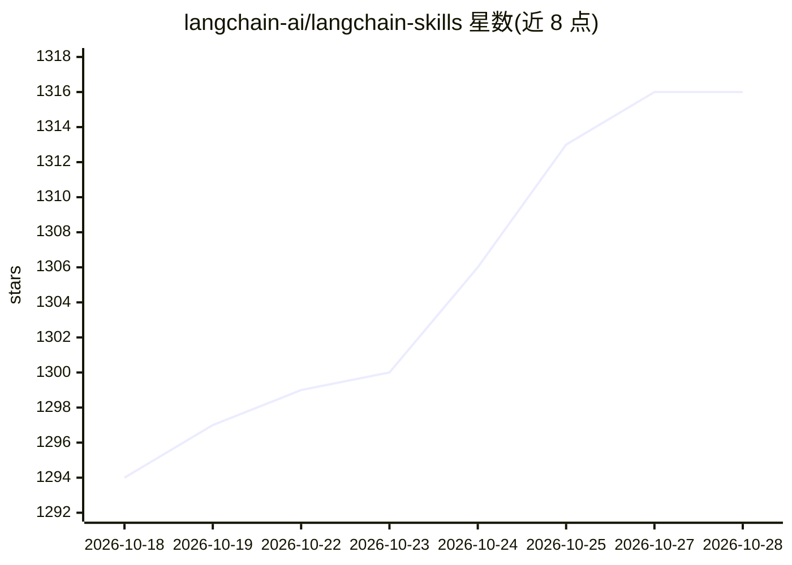

# langchain-ai/langchain-skills

⭐ 1,316 · TypeScript · MIT · 推送 2026-10-25 · [GitHub](https://github.com/langchain-ai/langchain-skills) · 组织维护

**LangChain/LangGraph/Deep Agents 的 agent 技能库（21 个 SKILL.md）**

LangChain 官方维护的编码 agent 技能集合：提供 21 个 SKILL.md 格式技能，覆盖 LangChain/LangGraph/Deep Agents 框架入门、快速启动模板、RAG、人机协同、持久化、编排与基于 Harbor 的评测工程等内容。通过 npx skills 安装到支持 Agent Skills 规范的编码 agent（Claude Code、Cursor、Windsurf、Codex 等），也可作为 Claude Code 插件或经 install.sh 脚本安装。项目自述处于早期开发阶段，API 与技能内容可能变化。

## 筛选速览

| 维度 | 判定 | 备注 |
|---|---|---|
| AI 角色 | `ai-knowledge` | 知识聚合/清单类 |
| 许可风险 | `permissive` | MIT |
| 部署形态 | `library` | 以包/库形式分发 |
| 模型依赖 | — | README 未给出锁定关系 |
| 硬件要求 | — | 无带数字的原话,不猜 |
| 安装摩擦 | `low` | 无编译、无系统依赖或容器化 |
| 成熟度 | `idea` | |

## 能力要点

- 21 个技能覆盖 LangChain / LangGraph / Deep Agents 全栈主题
- 支持 npx skills、Claude Code 插件、install.sh 脚本三种安装方式
- 兼容任何支持 Agent Skills 规范的编码 agent
- eval-engineering 技能需配合 Harbor（Docker 本地或云端）运行

## 适用场景

- 让 Claude Code / Cursor 等编码 agent 掌握 LangChain 生态开发知识
- 快速生成 LangChain 或 LangGraph 项目起步代码
- 在编码 agent 中设计基于 Harbor 的评测任务

## 场景标签

`代码生成` `模型评测` `教程课程` · 领域:编码与开发

## 证据(README 行号)

> L5: Agent skills for building agents with LangChain, LangGraph, and Deep Agents.
> L98: ## Available Skills (21)

## 星数曲线

2026-10-18 1,294 → 2026-10-28 1,316（+22）

---
*卡片 v1 · prompt 1.4 · 生成 2026-10-21 · 置信度 high · 依据 README sha `ef3a270375cc` · [字段定义](../../DATASET.md)*
