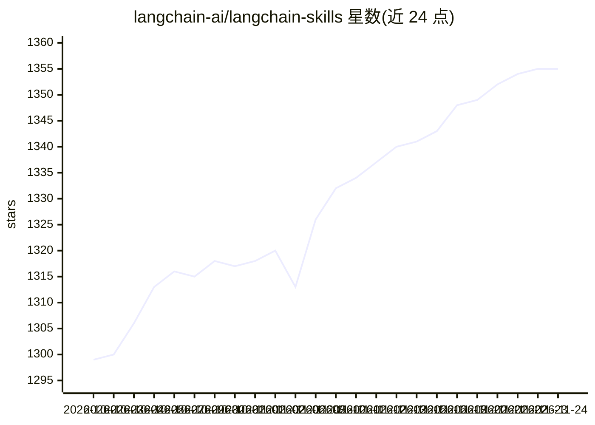

# langchain-ai/langchain-skills

⭐ 1,355 · Python · MIT · 推送 2026-11-21 · [GitHub](https://github.com/langchain-ai/langchain-skills) · 组织维护

**为 LangChain/LangGraph/LangSmith 开发提供技能包的插件仓库**

由 LangChain 团队维护的编码 Agent 技能（skills）集合，为使用 Deep Agents、LangGraph、LangChain 构建应用、用 LangSmith 做评测、以及编写 Harbor 基准提供指导性技能内容。以 Claude Code/Codex/Deep Agents Code 插件形式安装，捆绑官方文档与 API 参考 MCP 服务器；也支持 npx skills 单独安装或克隆仓库用 install.sh/install.ps1 链接或复制安装。项目处于早期开发阶段，API 与技能内容可能变更。

## 筛选速览

| 维度 | 判定 | 备注 |
|---|---|---|
| AI 角色 | `ai-knowledge` | 知识聚合/清单类 |
| 许可风险 | `permissive` | MIT |
| 部署形态 | `library` | 以包/库形式分发 |
| 模型依赖 | — | README 未给出锁定关系 |
| 硬件要求 | — | 无带数字的原话,不猜 |
| 安装摩擦 | `low` | 无编译、无系统依赖或容器化 |
| 成熟度 | `idea` | |

## 能力要点

- 插件安装捆绑 langchain-docs 与 langchain-reference 两个文档 MCP 服务器
- 支持 Claude Code、Codex、Deep Agents Code 三种插件市场安装方式
- 兼容 Agent Skills 规范的代理可经 npx skills 安装，含全局/项目级、链接/复制模式
- CI 校验技能中引用的 LangSmith CLI 命令与 flag 的有效性

## 适用场景

- 让 Claude Code 等编码代理掌握 LangChain/LangGraph 开发指南
- 在编码代理中查询官方文档与 API 参考（含离线回退路径）
- 通过 LangSmith CLI 由代理查询与管理评测工作区

## 场景标签

`编码 Agent` · 领域:编码与开发

## 证据(README 行号)

> L5: Opinionated skills for building applications with Deep Agents, LangGraph, and
> L15: For agents that support the Agent Skills specification,

## 星数曲线

2026-10-22 1,299 → 2026-11-24 1,355（+56）

---
*卡片 v1 · prompt 1.4 · 生成 2026-11-23 · 置信度 high · 依据 README sha `62ce4b572075` · [字段定义](../../DATASET.md)*
