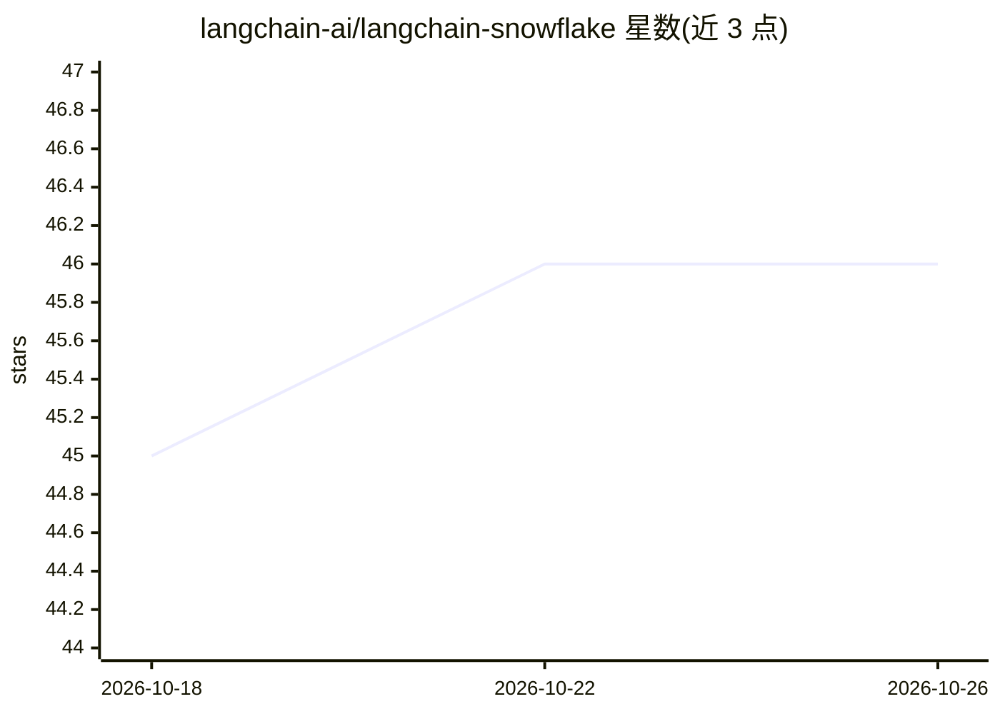

# langchain-ai/langchain-snowflake

⭐ 46 · Python · MIT · 推送 2026-10-22 · [GitHub](https://github.com/langchain-ai/langchain-snowflake) · 组织维护

**Snowflake Cortex AI 的 LangChain/LangGraph 集成包**

langchain-ai 维护的官方集成包，提供 langchain-snowflake 一个 Python 包，将 Snowflake Cortex AI 接入 LangChain/LangGraph 生态：覆盖 Cortex 上的聊天模型（Claude、Llama、Mistral、GPT-4）、工具调用、结构化输出与流式响应，并封装 Cortex Search 语义检索、Cortex Analyst 自然语言转 SQL、Cortex Agents 编排与 Cortex Complete 文本生成。认证方式包括密码、PAT、密钥对与 SSO，内置 LangSmith 可观测性集成，附带 50+ 测试。面向使用 Snowflake 数据云的开发者，通过 pip 安装。

## 筛选速览

| 维度 | 判定 | 备注 |
|---|---|---|
| AI 角色 | `ai-ecosystem` | LLM/agent 周边工具 |
| 许可风险 | `permissive` | MIT |
| 部署形态 | `library` | 以包/库形式分发 |
| 模型依赖 | — | README 未给出锁定关系 |
| 硬件要求 | — | 无带数字的原话,不猜 |
| 安装摩擦 | `low` | 无编译、无系统依赖或容器化 |
| 成熟度 | — | 结构信号不足 |

## 能力要点

- Cortex 聊天模型接入 LangChain（Claude/Llama/Mistral/GPT-4）
- Cortex Search/Analyst/Agents/Complete 四类服务封装
- Password/PAT/Key Pair/SSO 多种认证方式
- LangSmith 内置追踪与 50+ 测试覆盖

## 适用场景

- 在 LangChain 应用中调用 Snowflake Cortex 托管的 LLM
- 通过 Cortex Analyst 用自然语言查询 Snowflake 数据生成 SQL
- 构建基于 Cortex Search 的语义检索与 RAG 流程

## 场景标签

`RAG` `语义搜索` `数据分析` · 领域:效率与自动化

## 证据(README 行号)

> L3: This repository contains 1 package with Snowflake integrations with Langchain/Langgraph:
> L7: Langchain / Langgraph integration for Snowflake Cortex AI. Native support for chat models, tools, and retrieval with

## 星数曲线

2026-10-18 45 → 2026-10-26 46（+1）

---
*卡片 v1 · prompt 1.4 · 生成 2026-10-25 · 置信度 high · 依据 README sha `dcfffa782738` · [字段定义](../../DATASET.md)*
