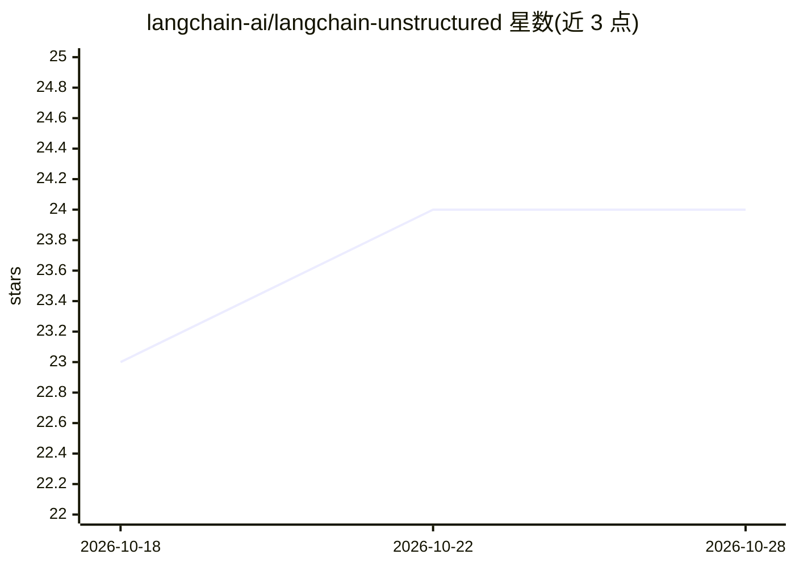

# langchain-ai/langchain-unstructured

⭐ 23 · Python · MIT · 推送 2026-10-25 · [GitHub](https://github.com/langchain-ai/langchain-unstructured) · 组织维护

**LangChain 与 Unstructured 的集成包，用于文档解析加载**

langchain-ai 组织下的集成仓库，包含 1 个包 langchain-unstructured，将 Unstructured 的文档解析能力接入 LangChain 生态，作为文档加载/分区组件供构建 LLM 应用的开发者使用。README 仅列出包名，功能细节、安装命令与使用示例未在可见范围内展示。

## 筛选速览

| 维度 | 判定 | 备注 |
|---|---|---|
| AI 角色 | `ai-ecosystem` | LLM/agent 周边工具 |
| 许可风险 | `permissive` | MIT |
| 部署形态 | `None` |  |
| 模型依赖 | — | README 未给出锁定关系 |
| 硬件要求 | — | 无带数字的原话,不猜 |
| 安装摩擦 | `low` | 无编译、无系统依赖或容器化 |
| 成熟度 | — | 结构信号不足 |

## 能力要点

- langchain-ai 官方组织维护的集成仓库
- 提供 langchain-unstructured 集成包
- 将 Unstructured 文档解析接入 LangChain

## 适用场景

- 在 LangChain 应用中加载与解析多种格式的文档
- 为 RAG 流程提供文档分区与预处理能力

## 场景标签

`文档解析` · 领域:知识与检索

## 证据(README 行号)

> L3: This repository contains 1 package with Unstructured integrations with LangChain:

## 星数曲线

2026-10-18 23 → 2026-10-28 24（+1）

---
*卡片 v1 · prompt 1.4 · 生成 2026-10-27 · 置信度 mid · 依据 README sha `66e8662f1e9d` · [字段定义](../../DATASET.md)*
