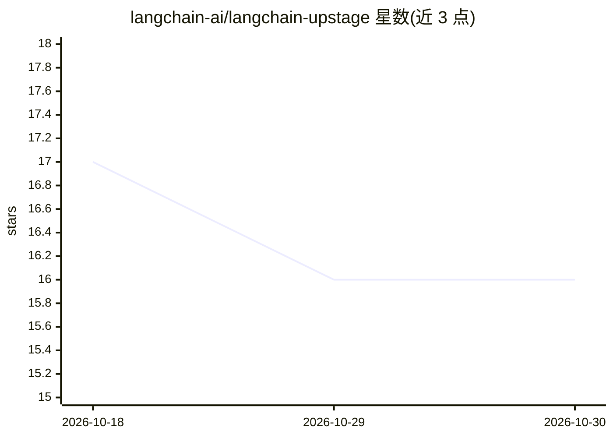

# langchain-ai/langchain-upstage

⭐ 16 · Python · MIT · 推送 2026-10-25 · [GitHub](https://github.com/langchain-ai/langchain-upstage) · 组织维护

**LangChain 的 Upstage 模型集成包**

langchain-ai 组织下的集成仓库，包含单一 Python 包 langchain-upstage，将 Upstage 的模型服务接入 LangChain 生态，使 LangChain 用户可调用 Upstage 的能力。README 仅说明包的定位与发布流程（版本号更新、rc 版本发布、验证与正式发布步骤），未列出具体功能细节、安装命令或使用示例，安装方式需参考包内文档。

## 筛选速览

| 维度 | 判定 | 备注 |
|---|---|---|
| AI 角色 | `ai-ecosystem` | LLM/agent 周边工具 |
| 许可风险 | `permissive` | MIT |
| 部署形态 | `None` |  |
| 模型依赖 | — | README 未给出锁定关系 |
| 硬件要求 | — | 无带数字的原话,不猜 |
| 安装摩擦 | `low` | 无编译、无系统依赖或容器化 |
| 成熟度 | — | 结构信号不足 |

## 能力要点

- langchain-upstage 单包集成 Upstage 与 LangChain
- 由 langchain-ai 组织维护的官方集成仓库
- README 记录 rc 版本迭代发布流程

## 适用场景

- 在 LangChain 应用中调用 Upstage 模型服务
- 跟随 Upstage 集成的版本发布获取更新

## 场景标签

 · 领域:LLM 基础设施/框架集成

## 证据(README 行号)

> L3: This repository contains 1 package with Upstage integrations with LangChain:
> L5: - langchain-upstage integrates Upstage.

## 星数曲线

2026-10-18 17 → 2026-10-30 16（-1）

---
*卡片 v1 · prompt 1.4 · 生成 2026-10-30 · 置信度 mid · 依据 README sha `85b291bddb45` · [字段定义](../../DATASET.md)*
