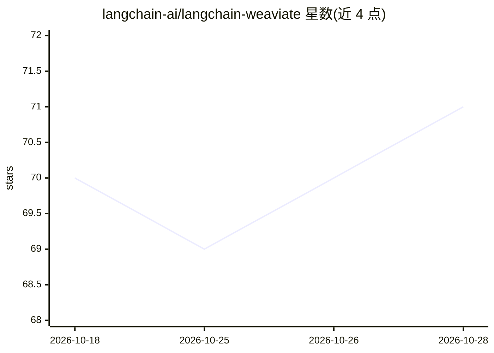

# langchain-ai/langchain-weaviate

⭐ 71 · Python · MIT · 推送 2026-10-25 · [GitHub](https://github.com/langchain-ai/langchain-weaviate) · [官网](https://docs.langchain.com/oss/python/integrations/providers/weaviate) · 组织维护

**LangChain 与 Weaviate 向量数据库的集成接口包**

官方集成包，将 Weaviate 向量数据库接入 LangChain 生态，供开发者在链或检索流程中使用 Weaviate 存取向量与检索。提供可选的 simsimd 加速：安装后余弦距离计算走加速路径，未安装则自动回退到纯 NumPy/SciPy 实现，兼容包括旧 glibc 在内的各环境。README 较简略，主要面向已使用 LangChain 的开发者。

## 筛选速览

| 维度 | 判定 | 备注 |
|---|---|---|
| AI 角色 | `ai-ecosystem` | LLM/agent 周边工具 |
| 许可风险 | `permissive` | MIT |
| 部署形态 | `library` | 以包/库形式分发 |
| 模型依赖 | — | README 未给出锁定关系 |
| 硬件要求 | — | 无带数字的原话,不猜 |
| 安装摩擦 | `low` | 无编译、无系统依赖或容器化 |
| 成熟度 | — | 结构信号不足 |

## 能力要点

- 将 Weaviate 集成进 LangChain
- simsimd 可选加速向量余弦距离计算
- 无 simsimd 时自动回退到 NumPy/SciPy 实现

## 适用场景

- 在 LangChain 应用中使用 Weaviate 作为向量存储
- 需要加速向量检索计算的 LangChain 项目

## 场景标签

`RAG` · 领域:知识与检索

## 证据(README 行号)

> L3: This repository contains 1 package with Weaviate integrations with LangChain:
> L5: - langchain-weaviate integrates Weaviate.

## 星数曲线

2026-10-18 70 → 2026-10-28 71（+1）

---
*卡片 v1 · prompt 1.4 · 生成 2026-10-24 · 置信度 high · 依据 README sha `ae12eda65b1f` · [字段定义](../../DATASET.md)*
