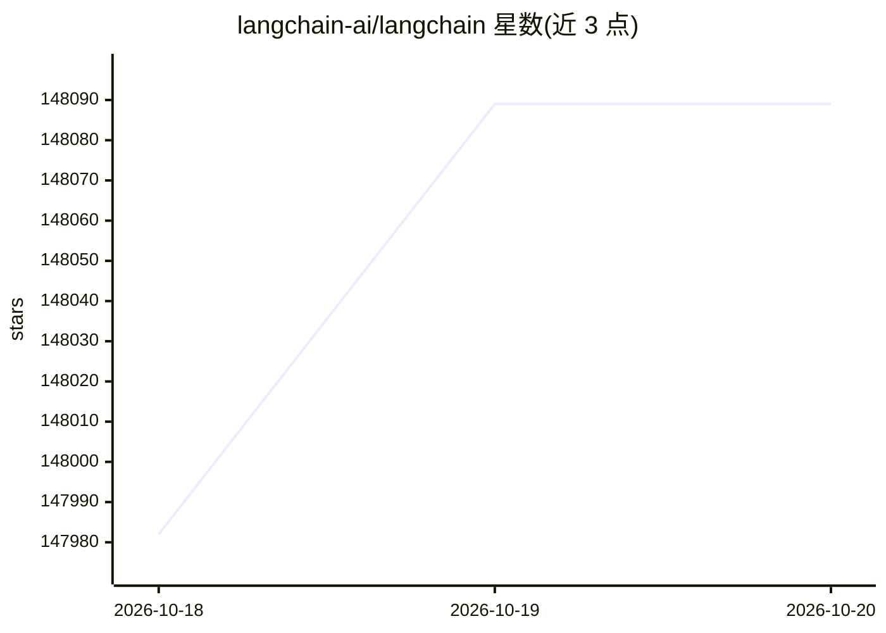

# langchain-ai/langchain

⭐ 148,089 · Python · MIT · 推送 2026-10-19 · [GitHub](https://github.com/langchain-ai/langchain) · [官网](https://docs.langchain.com/langchain/) · 组织维护

**面向开发者的构建 agent 与 LLM 应用的框架**

LangChain 是用于构建 agent 和 LLM 应用的 Python 框架，通过标准接口统一模型、嵌入、向量存储等组件，支持可互换的第三方集成。提供 init_chat_model 统一入口调用各厂商模型，经 uv/pip 从 PyPI 安装。同生态包含 Deep Agents（高层 agent 包）、LangGraph（底层编排框架）、LangSmith（评估/观测/部署），并提供 JS/TS 版本。README 未给出具体模型接入配置细节，需查文档。

## 筛选速览

| 维度 | 判定 | 备注 |
|---|---|---|
| AI 角色 | `ai-native` | 本体是模型或模型工具 |
| 许可风险 | `permissive` | MIT |
| 部署形态 | `library` | 以包/库形式分发 |
| 模型依赖 | — | README 未给出锁定关系 |
| 硬件要求 | — | 无带数字的原话,不猜 |
| 安装摩擦 | `low` | 无编译、无系统依赖或容器化 |
| 成熟度 | — | 结构信号不足 |

## 动量与使用信号

- 维护:`active` — 距上次 push 0.9 天,年发版 100,467 位贡献者
- 涨星:近 1 天 **+68**(自 20261016 起算)

## 能力要点

- 模型、嵌入、向量存储等组件的标准接口与可互换性
- 与 LangGraph、Deep Agents、LangSmith 组成的产品矩阵
- uv add langchain 一条命令安装
- 同时提供 JS/TS 等效库 LangChain.js

## 适用场景

- 开发由 LLM 驱动的应用原型并快速迭代
- 构建需要编排多步骤任务的 agent 工作流
- 在实验中切换比较不同模型供应商

## 场景标签

`Agent 框架` · 领域:Agent 开发

## 证据(README 行号)

> L14: LangChain is a framework for building agents and LLM-powered applications. It helps you chain together interoperabl
> L22: uv add langchain

## 星数曲线

2026-10-18 147,982 → 2026-10-20 148,089（+107）

---
*卡片 v1 · prompt 1.4 · 生成 2026-10-18 · 置信度 high · 依据 README sha `56283ab172b8` · [字段定义](../../DATASET.md)*
