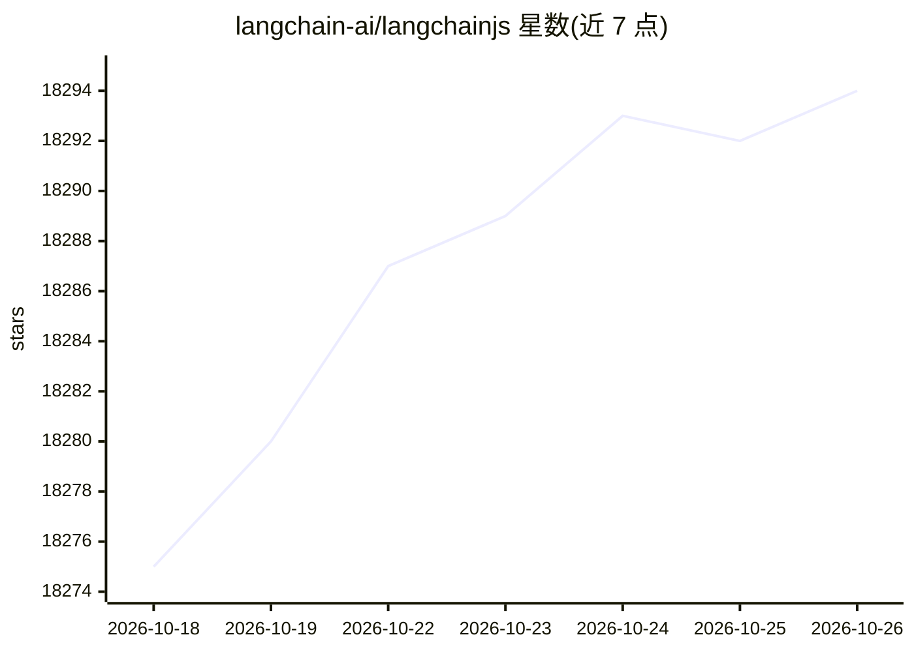

# langchain-ai/langchainjs

⭐ 18,294 · TypeScript · MIT · 推送 2026-10-23 · [GitHub](https://github.com/langchain-ai/langchainjs) · [官网](https://docs.langchain.com/langchain/) · 组织维护

**JavaScript 开发者构建 LLM 应用的组件化框架**

LangChain.js 是 TypeScript 编写的框架，用于构建由 LLM 驱动的应用：提供 agents、models、embeddings、vector stores 等的统一接口，可组合互操作组件与第三方集成。README 列出数据增强、模型互换、快速原型等用途，并指向生态内的 Deep Agents、LangGraph.js（agent 编排）与 LangSmith（构建/测试/监控平台）。通过 npm/pnpm/yarn 安装，支持 Node.js、Cloudflare Workers、浏览器、Deno、Bun 等运行环境。

## 筛选速览

| 维度 | 判定 | 备注 |
|---|---|---|
| AI 角色 | `ai-native` | 本体是模型或模型工具 |
| 许可风险 | `permissive` | MIT |
| 部署形态 | `library` | 以包/库形式分发 |
| 模型依赖 | — | README 未给出锁定关系 |
| 硬件要求 | — | 无带数字的原话,不猜 |
| 安装摩擦 | `low` | 无编译、无系统依赖或容器化 |
| 成熟度 | — | 结构信号不足 |

## 动量与使用信号

- 维护:`active` — 距上次 push 0.7 天,年发版 100,441 位贡献者
- 涨星:近 1 天 **+2**(自 20261016 起算)
- 安装:npm 包 `langchain` 月下载 12,760,965

## 能力要点

- 为 agents、模型、嵌入、向量库等提供统一标准接口
- 可替换模型的互操作层，含模型供应商/工具/向量库集成库
- 支持 Node.js、Cloudflare Workers、Vercel/Next.js、Deno、Bun 等多种环境
- npm/pnpm/yarn 三种包管理器安装

## 适用场景

- 用 TypeScript 构建 LLM 驱动的应用与 agent
- 在不同模型供应商之间切换以测试选型
- 连接 LLM 与内部/外部数据源做检索增强
- 从原型到生产部署 LLM 应用（配合 LangSmith 监控调试）

## 场景标签

`Agent 框架` `RAG` · 领域:Agent 开发

## 证据(README 行号)

> L11: LangChain is a framework for building LLM-powered applications. It helps you chain together interoperable component
> L32: LangChain helps developers build applications powered by LLMs through a standard interface for agents, models, embe
> L55: - Node.js (ESM and CommonJS) - 20.x, 22.x, 24.x

## 星数曲线

2026-10-18 18,275 → 2026-10-26 18,294（+19）

---
*卡片 v1 · prompt 1.4 · 生成 2026-10-18 · 置信度 high · 依据 README sha `2ea6401b52ba` · [字段定义](../../DATASET.md)*
