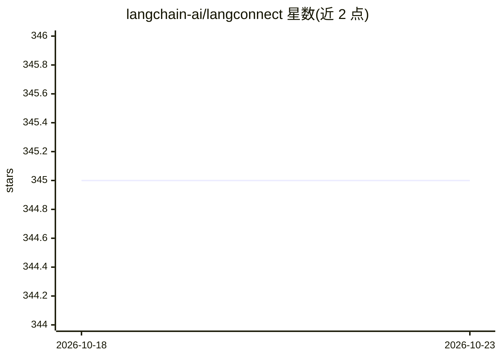

# langchain-ai/langconnect

⭐ 345 · Python · MIT · 推送 2026-10-21 · [GitHub](https://github.com/langchain-ai/langconnect) · 组织维护

**基于 FastAPI 与 LangChain 的托管 RAG REST API 服务**

LangConnect 是一个用 FastAPI 与 LangChain 构建的 RAG 服务，提供 REST API 用于管理集合与文档，采用 PostgreSQL 与 pgvector 存储文档和向量嵌入。提供集合与文档的增删查及语义搜索端点，通过 Docker Compose 部署，可一键启动 PostgreSQL（pgvector 扩展）与 API 服务，并支持开发模式热重载。面向需要自托管 RAG 文档管理与检索 API 的开发者。README 未说明支持的嵌入/LLM 提供商配置细节。

## 筛选速览

| 维度 | 判定 | 备注 |
|---|---|---|
| AI 角色 | `ai-ecosystem` | LLM/agent 周边工具 |
| 许可风险 | `permissive` | MIT |
| 部署形态 | `self-host` | docker 或自建部署 |
| 模型依赖 | — | README 未给出锁定关系 |
| 硬件要求 | — | 无带数字的原话,不猜 |
| 安装摩擦 | `low` | 无编译、无系统依赖或容器化 |
| 成熟度 | — | 结构信号不足 |

## 能力要点

- FastAPI REST API 管理集合与文档
- PostgreSQL + pgvector 向量存储
- Docker Compose 一键部署并支持开发模式热重载
- 提供语义搜索端点

## 适用场景

- 自托管一套文档集合管理与语义检索 API
- 为应用提供带 pgvector 向量存储的 RAG 后端
- 通过 OpenAPI 文档快速调试检索接口

## 场景标签

`RAG` `语义搜索` · 领域:知识与检索

## 证据(README 行号)

> L3: LangConnect is a RAG (Retrieval-Augmented Generation) service built with FastAPI and LangChain. It provides a REST A
> L7: - FastAPI-based REST API

## 星数曲线

2026-10-18 345 → 2026-10-23 345（+0）

---
*卡片 v1 · prompt 1.4 · 生成 2026-10-21 · 置信度 high · 依据 README sha `7eb2e1a3d83d` · [字段定义](../../DATASET.md)*
