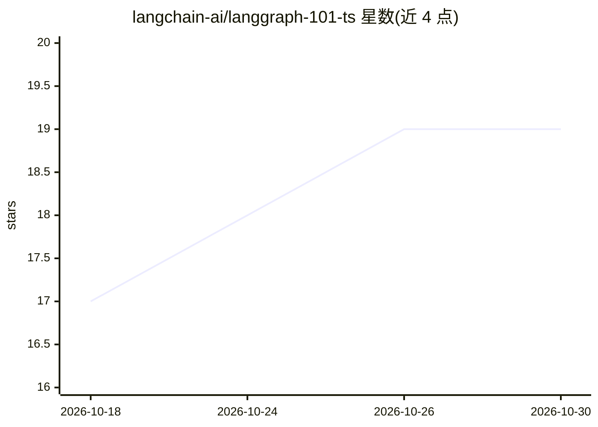

# langchain-ai/langgraph-101-ts

⭐ 19 · TypeScript · MIT · 推送 2026-10-28 · [GitHub](https://github.com/langchain-ai/langgraph-101-ts) · 组织维护

**LangGraph/LangChain TypeScript Agent 开发实训教程仓库**

由 LangChain 团队维护的 TypeScript 动手实训（workshop）仓库：两条独立学习路径——101 基础（6 个渐进式 agent，覆盖工具、状态图、多 agent 监督者、human-in-the-loop、记忆与 4 个评测脚本）和 Deep Agents（14 个渐进式 agent，覆盖 Deep Agents harness、子 agent、中间件、长期记忆与技能）。每个 workshop 自带 package.json、langgraph.json 与 README，经 git clone 获取后按各目录 README 安装依赖并启动 LangGraph Studio。为 LangChain Academy 的精简版，设计为配合 LangChain 工程师现场授课使用。

## 筛选速览

| 维度 | 判定 | 备注 |
|---|---|---|
| AI 角色 | `ai-knowledge` | 知识聚合/清单类 |
| 许可风险 | `permissive` | MIT |
| 部署形态 | `None` |  |
| 模型依赖 | — | README 未给出锁定关系 |
| 硬件要求 | — | 无带数字的原话,不猜 |
| 安装摩擦 | `low` | 无编译、无系统依赖或容器化 |
| 成熟度 | — | 结构信号不足 |

## 能力要点

- 101 路径含 6 个渐进式 agent 与 4 个评测脚本
- Deep Agents 路径含 14 个 agent，覆盖子 agent/中间件/长期记忆/技能
- 每个 workshop 独立自包含，附 langgraph.json 与 .env.example
- 提供推荐学习路径与各 workshop README 安装指引

## 适用场景

- 系统学习用 LangGraph 构建 agent 与多 agent 应用
- 跟随渐进式示例掌握 human-in-the-loop 与记忆等模式
- 从零搭建完整的研究型 Deep Agent

## 场景标签

`教程课程` · 领域:学习与行业

## 证据(README 行号)

> L7: This repository contains hands-on TypeScript workshops for learning to build agents with LangChain and LangGraph, or
> L9: - **101 - Fundamentals**: Build agents from scratch with LangChain v1 and LangGraph v1 -- tools, state, multi-agent 
> L12: This is a condensed version of LangChain Academy, intended to be run in a session with a LangChain engineer. If you

## 星数曲线

2026-10-18 17 → 2026-10-30 19（+2）

---
*卡片 v1 · prompt 1.4 · 生成 2026-10-28 · 置信度 high · 依据 README sha `d29ce4838a46` · [字段定义](../../DATASET.md)*
