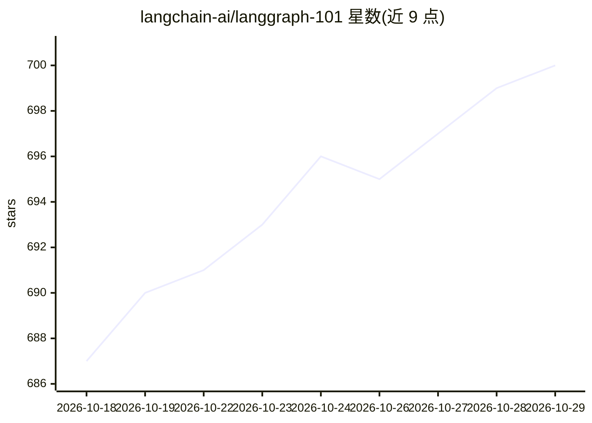

# langchain-ai/langgraph-101

⭐ 700 · Jupyter Notebook · MIT · 推送 2026-10-23 · [GitHub](https://github.com/langchain-ai/langgraph-101) · 组织维护

**LangGraph 官方入门教程库：用 notebook 学习构建 agent**

LangChain 团队维护的动手教程仓库，分 101/201 两条学习路径：101 覆盖 LangChain/LangGraph 基础、middleware、human-in-the-loop 与 guardrails；201 覆盖邮件分拣 agent、多 agent 系统、深度研究 agent 与 DeepAgents 构建。附 5 个可在 LangGraph Studio（langgraph dev）运行的独立 agent 实现。模型配置集中于 utils/models.py，默认 OpenAI o3-mini，支持切换 Azure OpenAI、AWS Bedrock、Google Vertex AI。定位为 LangChain Academy 的精简版，设计上配合 LangChain 工程师带讲使用。

## 筛选速览

| 维度 | 判定 | 备注 |
|---|---|---|
| AI 角色 | `ai-knowledge` | 知识聚合/清单类 |
| 许可风险 | `permissive` | MIT |
| 部署形态 | `library` | 以包/库形式分发 |
| 模型依赖 | — | README 未给出锁定关系 |
| 硬件要求 | — | 无带数字的原话,不猜 |
| 安装摩擦 | `low` | 无编译、无系统依赖或容器化 |
| 成熟度 | — | 结构信号不足 |

## 能力要点

- 两条学习路径：基础（101）与生产模式（201）的 notebook 教程
- 5 个独立 agent 实现可用 langgraph dev 在 LangGraph Studio 本地运行
- 集中式模型配置模块，支持 OpenAI/Azure/Bedrock/Vertex AI 切换
- 覆盖 multi-agent、DeepAgents、HITL、guardrails 等模式

## 适用场景

- 按推荐路径学习 LangChain/LangGraph/Deep Agents
- 在 LangGraph Studio 中运行和调试示例 agent
- 参考邮件分拣、多 agent、深度研究等生产模式实现

## 场景标签

`教程课程` · 领域:学习与行业

## 证据(README 行号)

> L6: This repository contains hands-on tutorials for learning LangChain, LangGraph, and Deep Agents, organized into two l
> L13: This is a condensed version of LangChain Academy, intended to be run in a session with a LangChain engineer. If you

## 星数曲线

2026-10-18 687 → 2026-10-29 700（+13）

---
*卡片 v1 · prompt 1.4 · 生成 2026-10-21 · 置信度 mid · 依据 README sha `91e07145e14b` · [字段定义](../../DATASET.md)*
