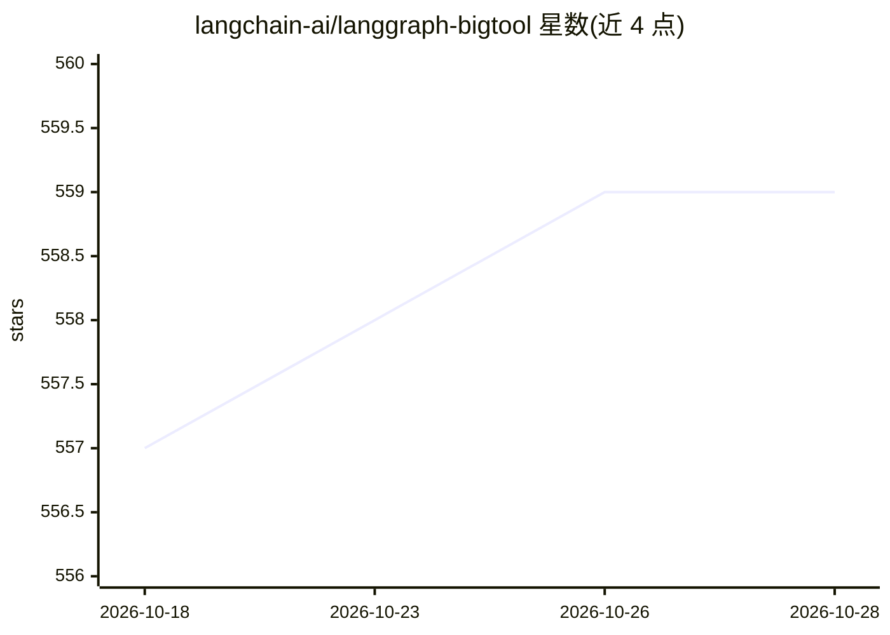

# langchain-ai/langgraph-bigtool

⭐ 559 · Python · MIT · 推送 2026-10-24 · [GitHub](https://github.com/langchain-ai/langgraph-bigtool) · 组织维护

**Python 库：为 LangGraph agent 提供海量工具的检索接入**

langchain-ai 团队维护的 Python 库，基于 LangGraph 长期记忆存储，让 agent 在拥有成百上千个工具时按问题检索并加载相关工具，而非一次性全部注入。工具元数据通过 LangGraph 持久层存储，支持内存与 Postgres 后端；可自定义工具检索函数，也可不依赖 LangGraph Store 实现任意检索逻辑。以 pip 安装，构建于 LangGraph 之上，继承流式、短期/长期记忆与 human-in-the-loop 支持。

## 筛选速览

| 维度 | 判定 | 备注 |
|---|---|---|
| AI 角色 | `ai-ecosystem` | LLM/agent 周边工具 |
| 许可风险 | `permissive` | MIT |
| 部署形态 | `library` | 以包/库形式分发 |
| 模型依赖 | — | README 未给出锁定关系 |
| 硬件要求 | — | 无带数字的原话,不猜 |
| 安装摩擦 | `low` | 无编译、无系统依赖或容器化 |
| 成熟度 | — | 结构信号不足 |

## 能力要点

- 支持为 agent 配备数百至数千个工具并按需检索
- 工具元数据经 LangGraph 持久层存储，支持内存与 Postgres 后端
- 可自定义工具检索函数，或脱离 Store 实现任意检索逻辑

## 适用场景

- agent 工具数量超出 LLM 单次调用承载时的工具检索
- 按类别或语义检索为 agent 动态装载工具
- 需要集中管理大量工具描述与命名空间的 agent 应用

## 场景标签

`Agent 框架` · 领域:Agent 开发

## 证据(README 行号)

> L3: `langgraph-bigtool` is a Python library for creating
> L22: This library is built on top of LangGraph, a powerful framework for building agent applications, and comes with out

## 星数曲线

2026-10-18 557 → 2026-10-28 559（+2）

---
*卡片 v1 · prompt 1.4 · 生成 2026-10-21 · 置信度 high · 依据 README sha `c040295f0cfb` · [字段定义](../../DATASET.md)*
