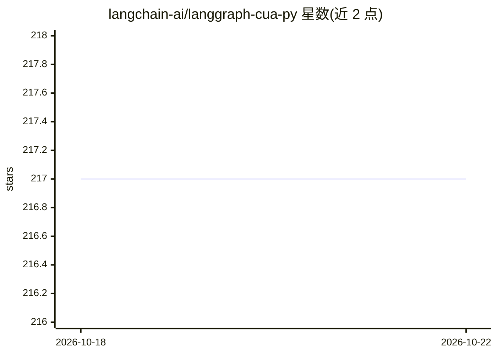

# langchain-ai/langgraph-cua-py

⭐ 217 · Python · MIT · 推送 2026-10-19 · [GitHub](https://github.com/langchain-ai/langgraph-cua-py) · 组织维护

**基于 LangGraph 的计算机使用代理（CUA）Python 库**

用于构建计算机使用代理（Computer Use Agent）系统的 Python 库：代理在虚拟机中操作计算机（web/Ubuntu/Windows 环境）以执行任务，底层基于 LangGraph，自带流式输出、短期/长期记忆与 human-in-the-loop 支持。默认通过 Scrapybara 访问虚拟机，需 OpenAI 与 Scrapybara API key；支持认证状态持久化复用浏览器会话、Zero Data Retention 模式，可通过 create_cua 的配置参数（超时、递归上限、系统提示等）定制。面向使用 pip 安装的开发者。

## 筛选速览

| 维度 | 判定 | 备注 |
|---|---|---|
| AI 角色 | `ai-ecosystem` | LLM/agent 周边工具 |
| 许可风险 | `permissive` | MIT |
| 部署形态 | `library` | 以包/库形式分发 |
| 模型依赖 | — | README 未给出锁定关系 |
| 硬件要求 | — | 无带数字的原话,不猜 |
| 安装摩擦 | `low` | 无编译、无系统依赖或容器化 |
| 成熟度 | — | 结构信号不足 |

## 能力要点

- create_cua 一行创建 CUA 图，支持 web/Ubuntu/Windows 三种运行环境
- 基于 LangGraph，内置流式输出、记忆与 human-in-the-loop
- Scrapybara Auth States 持久化浏览器认证会话，可跨运行复用
- 支持 OpenAI Zero Data Retention（zdr_enabled）模式

## 适用场景

- 构建自动操作浏览器或虚拟机完成任务的代理
- 在沙箱环境中让代理执行研究、表单填写等计算机操作
- 复用已登录的浏览器会话让代理在认证站点执行操作

## 场景标签

`Agent 框架` `GUI 自动化` · 领域:Agent 开发

## 证据(README 行号)

> L6: A Python library for creating computer use agent (CUA) systems using LangGraph. A CUA is a type of agent which has t
> L18: This library is built on top of LangGraph, a powerful framework for building agent applications, and comes with out

## 星数曲线

2026-10-18 217 → 2026-10-22 217（+0）

---
*卡片 v1 · prompt 1.4 · 生成 2026-10-22 · 置信度 high · 依据 README sha `8e64cfca104d` · [字段定义](../../DATASET.md)*
