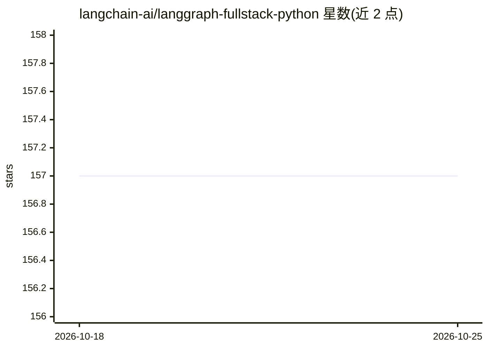

# langchain-ai/langgraph-fullstack-python

⭐ 157 · Python · MIT · 推送 2026-03-31 · [GitHub](https://github.com/langchain-ai/langgraph-fullstack-python) · 组织维护

**LangGraph 全栈聊天机器人模板：单部署内含 agent 与 Web UI**

langchain-ai 维护的 Python 模板项目，演示用 LangGraph 的 HTTP 配置能力构建全栈聊天机器人：agent 图定义于 graph.py，Web 界面用 FastHTML 与 DaisyUI 构建于 app.py，两者通过 langgraph.json 配置托管在单一 LangGraph 部署中。agent 采用 LangGraph 的 React agent 模式，经 Claude 3 模型处理消息并维护会话状态，可扩展自定义工具。安装依赖后用 langgraph dev 命令在 localhost:2024 本地运行。

## 筛选速览

| 维度 | 判定 | 备注 |
|---|---|---|
| AI 角色 | `ai-ecosystem` | LLM/agent 周边工具 |
| 许可风险 | `permissive` | MIT |
| 部署形态 | `library` | 以包/库形式分发 |
| 模型依赖 | — | README 未给出锁定关系 |
| 硬件要求 | — | 无带数字的原话,不猜 |
| 安装摩擦 | `low` | 无编译、无系统依赖或容器化 |
| 成熟度 | — | 结构信号不足 |

## 能力要点

- agent 与 UI 托管于单一 LangGraph 部署
- langgraph.json 同时配置 agent 图与 HTTP 路由
- React agent 模式（Claude 3 模型、会话状态、可加自定义工具）
- FastHTML + DaisyUI 构建的聊天界面，实时消息更新

## 适用场景

- 作为起点开发带 Web 界面的 LangGraph 聊天机器人
- 学习 LangGraph 的 HTTP 配置与单部署模式
- 快速原型验证 agent 与 UI 一体的应用

## 场景标签

`聊天机器人` · 领域:对话与助手

## 证据(README 行号)

> L7: This template demonstrates how to build a full-stack chatbot application using LangGraph's HTTP configuration capabi
> L13: - 🔄 **React-Style Agent** - Intelligent chatbot using LangGraph's React agent pattern

## 星数曲线

2026-10-18 157 → 2026-10-25 157（+0）

---
*卡片 v1 · prompt 1.4 · 生成 2026-10-22 · 置信度 high · 依据 README sha `c4f173ca1e81` · [字段定义](../../DATASET.md)*
