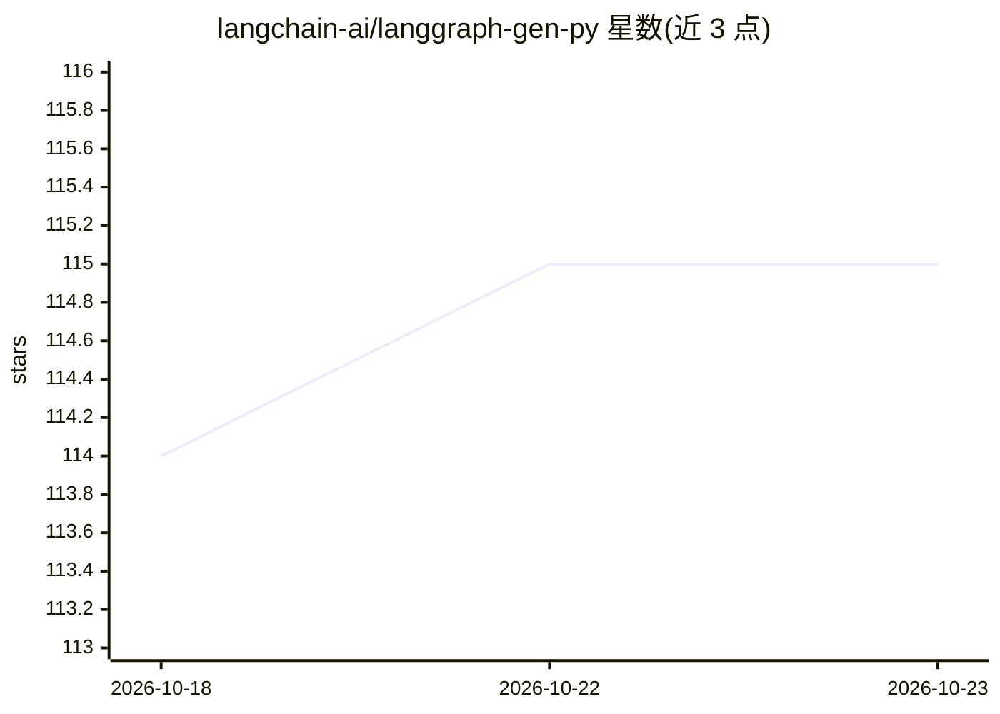

# langchain-ai/langgraph-gen-py

⭐ 115 · Python · MIT · 推送 2026-10-10 · [GitHub](https://github.com/langchain-ai/langgraph-gen-py) · 组织维护

**从 YAML 规格生成 LangGraph 存根代码的 CLI 工具**

LangChain 官方组织下的命令行工具：读取 YAML 规格文件（如定义节点与工作流的 RAG 示例），自动生成对应的 LangGraph Python 存根代码。面向使用 LangGraph 框架搭建工作流的开发者，用于快速从规格获得代码骨架，再自行补全节点逻辑。通过 pip 安装，仓库 examples 目录提供规格与生成结果示例。

## 筛选速览

| 维度 | 判定 | 备注 |
|---|---|---|
| AI 角色 | `ai-ecosystem` | LLM/agent 周边工具 |
| 许可风险 | `permissive` | MIT |
| 部署形态 | `library` | 以包/库形式分发 |
| 模型依赖 | — | README 未给出锁定关系 |
| 硬件要求 | — | 无带数字的原话,不猜 |
| 安装摩擦 | `low` | 无编译、无系统依赖或容器化 |
| 成熟度 | — | 结构信号不足 |

## 能力要点

- 从 YAML 规格文件生成 LangGraph Python 存根代码
- 提供命令行参数与快速上手示例
- examples 目录含规格文件与生成代码对照

## 适用场景

- 按规格快速生成 LangGraph 工作流代码骨架
- 在示例基础上定制自己的 RAG 等工作流结构

## 场景标签

`代码生成` · 领域:编码与开发

## 证据(README 行号)

> L3: langgraph-gen is a CLI tool that allows you to auto-generate a LangGraph stub from a
> L9: pip install langgraph-gen

## 星数曲线

2026-10-18 114 → 2026-10-23 115（+1）

---
*卡片 v1 · prompt 1.4 · 生成 2026-10-23 · 置信度 high · 依据 README sha `a2e3be95dd67` · [字段定义](../../DATASET.md)*
