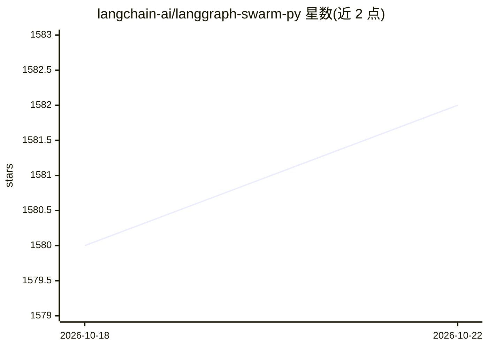

# langchain-ai/langgraph-swarm-py

⭐ 1,582 · Python · MIT · 推送 2026-09-20 · [GitHub](https://github.com/langchain-ai/langgraph-swarm-py) · [官网](https://langchain-ai.github.io/langgraph/concepts/multi_agent/) · 组织维护

**基于 LangGraph 的 Python 多智能体 swarm 构建库**

LangGraph 官方团队提供的 Python 库，用于构建 swarm 式多智能体系统：智能体依据各自专长通过 handoff 工具动态移交控制权，系统记录最后活跃的智能体以延续后续对话。基于 LangGraph 状态图实现，支持流式输出、短期/长期记忆与 human-in-the-loop；提供预置 create_handoff_tool，可自定义 handoff 工具、消息传递内容与智能体状态 schema。通过 pip 安装，需配合 LLM（如 OpenAI）使用。

## 筛选速览

| 维度 | 判定 | 备注 |
|---|---|---|
| AI 角色 | `ai-ecosystem` | LLM/agent 周边工具 |
| 许可风险 | `permissive` | MIT |
| 部署形态 | `library` | 以包/库形式分发 |
| 模型依赖 | — | README 未给出锁定关系 |
| 硬件要求 | — | 无带数字的原话,不猜 |
| 安装摩擦 | `low` | 无编译、无系统依赖或容器化 |
| 成熟度 | — | 结构信号不足 |

## 能力要点

- create_swarm 返回 StateGraph，可通过 compile 传入 checkpointer/store 实现记忆
- 预置 create_handoff_tool 并支持自定义 handoff 工具与传递数据
- 支持自定义状态 schema 隔离各智能体消息历史
- 支持流式输出与 human-in-the-loop（由 LangGraph 提供）

## 适用场景

- 构建多个专长智能体相互移交控制权的对话系统
- 搭建需要跨轮次记住活跃智能体的多智能体客服/助手
- 需要隔离各智能体内部消息历史的多 agent 应用

## 场景标签

`多智能体` `Agent 框架` · 领域:Agent 开发

## 证据(README 行号)

> L3: A Python library for creating swarm-style multi-agent systems using LangGraph. A swarm is a type of multi-agent arch
> L12: This library is built on top of LangGraph, a powerful framework for building agent applications, and comes with out

## 星数曲线

2026-10-18 1,580 → 2026-10-22 1,582（+2）

---
*卡片 v1 · prompt 1.4 · 生成 2026-10-21 · 置信度 high · 依据 README sha `7efe60f135f3` · [字段定义](../../DATASET.md)*
