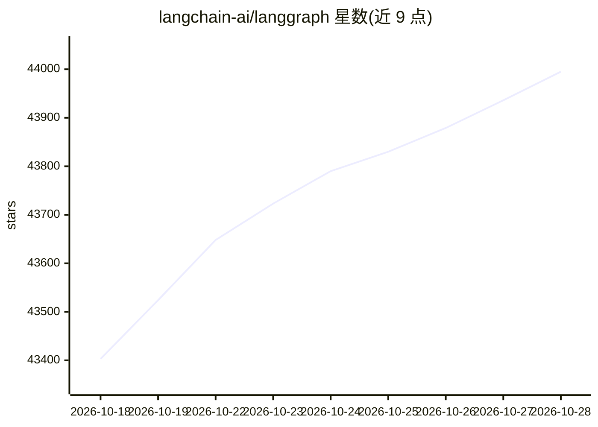

# langchain-ai/langgraph

⭐ 44,059 · Python · MIT · 推送 2026-10-28 · [GitHub](https://github.com/langchain-ai/langgraph) · [官网](https://docs.langchain.com/oss/python/langgraph/) · 组织维护

**面向构建有状态长期运行 agent 的低层编排框架**

LangGraph 是由 LangChain Inc 构建的 Python 库，用于构建、管理和部署长期运行的有状态 agent 与工作流。提供持久化执行（失败后自动从断点恢复）、人在回路（检查和修改执行状态）、短期与长期记忆、通过 LangSmith 调试追踪，以及面向生产环境的部署基础设施。可独立使用，也可与 LangChain 产品线配合使用；另提供 JS/TS 版本及更高层的 Deep Agents 包。

## 筛选速览

| 维度 | 判定 | 备注 |
|---|---|---|
| AI 角色 | `ai-native` | 本体是模型或模型工具 |
| 许可风险 | `permissive` | MIT |
| 部署形态 | `library` | 以包/库形式分发 |
| 模型依赖 | — | README 未给出锁定关系 |
| 硬件要求 | — | 无带数字的原话,不猜 |
| 安装摩擦 | `low` | 无编译、无系统依赖或容器化 |
| 成熟度 | — | 结构信号不足 |

## 动量与使用信号

- 维护:`active` — 距上次 push 0.6 天,年发版 100,283 位贡献者
- 涨星:近 1 天 **+55**(自 20261016 起算)
- 安装:pypi 包 `langgraph` 月下载 44,769,952

## 能力要点

- 持久化执行：agent 可跨故障运行并在断点处自动恢复
- 人在回路：执行过程中可检查与修改 agent 状态
- 短期工作记忆与跨会话长期记忆支持
- pip install -U langgraph 即可安装，另有 LangGraph.js 版本

## 适用场景

- 构建需要长期运行、可从故障中恢复的 agent 工作流
- 在 agent 执行中加入人工审批与状态修改
- 为团队部署可扩展的有状态 agent 系统

## 场景标签

`Agent 框架` `Agent 记忆` · 领域:Agent 开发

## 证据(README 行号)

> L7:  Low-level orchestration framework for building stateful agents.
> L14: Trusted by companies shaping the future of agents – including Klarna, Replit, Elastic, and more – LangGraph is a lo
> L68: LangGraph is inspired by Pregel and Apache Beam. The public interface draws inspiration from NetworkX. LangGraph is

## 星数曲线

2026-10-18 43,403 → 2026-10-28 43,995（+592）

---
*卡片 v1 · prompt 1.4 · 生成 2026-10-18 · 置信度 high · 依据 README sha `0df5a937a2b4` · [字段定义](../../DATASET.md)*
