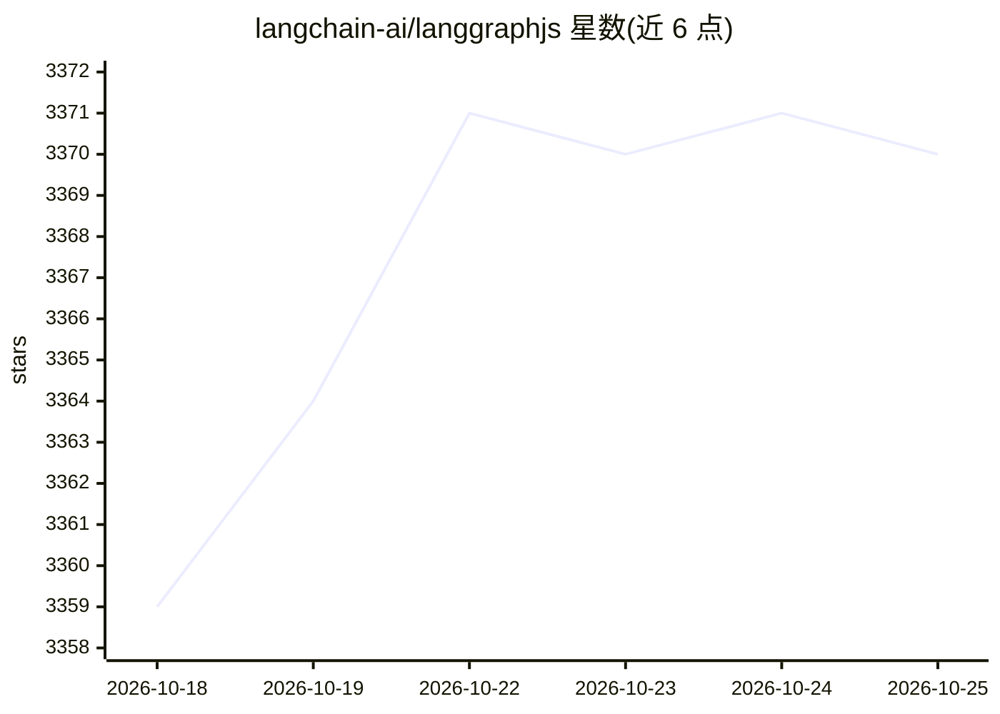

# langchain-ai/langgraphjs

⭐ 3,370 · TypeScript · MIT · 推送 2026-10-24 · [GitHub](https://github.com/langchain-ai/langgraphjs) · [官网](https://docs.langchain.com/oss/javascript/langgraph/) · 组织维护

**构建有状态智能体的低层编排框架（TypeScript）**

LangChain Inc 出品的 JavaScript/TypeScript 低层编排框架，以图结构构建可持久执行、有状态、长时运行的 agent：支持故障后自动恢复的 durable execution、任意节点人工介入的 human-in-the-loop、短期工作记忆与跨会话长期记忆，并可配合 LangSmith 做调试与可观测。通过 npm 安装 @langchain/langgraph，可独立于 LangChain 使用，也有对应的 Python 版本。

## 筛选速览

| 维度 | 判定 | 备注 |
|---|---|---|
| AI 角色 | `ai-ecosystem` | LLM/agent 周边工具 |
| 许可风险 | `permissive` | MIT |
| 部署形态 | `library` | 以包/库形式分发 |
| 模型依赖 | — | README 未给出锁定关系 |
| 硬件要求 | — | 无带数字的原话,不猜 |
| 安装摩擦 | `low` | 无编译、无系统依赖或容器化 |
| 成熟度 | — | 结构信号不足 |

## 能力要点

- 以图结构编排 agent，支持自定义架构
- Durable execution：故障后自动从断点恢复执行
- Human-in-the-loop：任意执行点检视并修改 agent 状态
- 短期工作记忆与跨会话长期记忆

## 适用场景

- 构建需要长期运行、可断点恢复的有状态 agent
- 在 agent 执行流程中插入人工审核节点
- 开发需要自定义编排架构而非固定流水线的 LLM 应用

## 场景标签

`Agent 框架` · 领域:Agent 开发

## 证据(README 行号)

> L7:  Low-level orchestration framework for building stateful agents.
> L27: LangGraph provides low-level supporting infrastructure for *any* long-running, stateful workflow or agent:
> L56: LangGraph is inspired by Pregel and Apache Beam. The public interface draws inspiration from NetworkX. LangGraph is

## 星数曲线

2026-10-18 3,359 → 2026-10-25 3,370（+11）

---
*卡片 v1 · prompt 1.4 · 生成 2026-10-20 · 置信度 high · 依据 README sha `3a33ec9f6571` · [字段定义](../../DATASET.md)*
