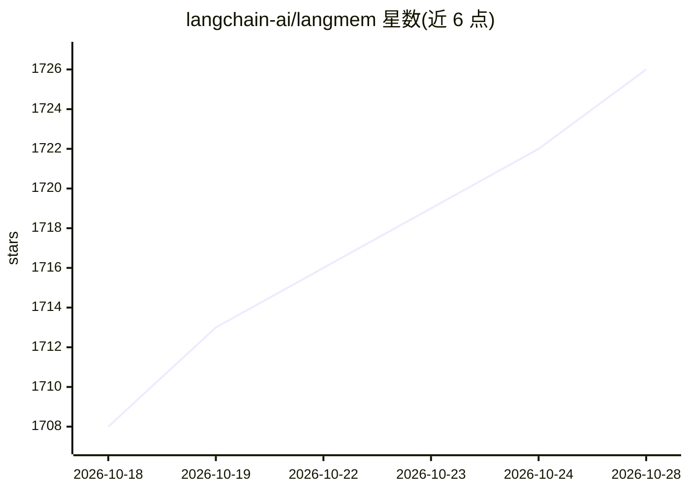

# langchain-ai/langmem

⭐ 1,726 · Python · MIT · 推送 2026-10-26 · [GitHub](https://github.com/langchain-ai/langmem) · [官网](https://langchain-ai.github.io/langmem/) · 组织维护

**让 LLM agent 从对话中提取并维护长期记忆的 Python 库**

面向构建 LangGraph 应用的开发者，提供 agent 长期记忆工具：记忆管理工具（存储/搜索）供 agent 在对话中即时调用，后台记忆管理器自动抽取、整合与更新知识；核心 Memory API 可配合任意存储系统，并与 LangGraph 的 Long-term Memory Store 原生集成。默认示例用 InMemoryStore（重启即失），生产环境需换用 AsyncPostgresStore 等数据库存储。需配置 LLM provider 的 API key（如 ANTHROPIC_API_KEY）。

## 筛选速览

| 维度 | 判定 | 备注 |
|---|---|---|
| AI 角色 | `ai-ecosystem` | LLM/agent 周边工具 |
| 许可风险 | `permissive` | MIT |
| 部署形态 | `library` | 以包/库形式分发 |
| 模型依赖 | — | README 未给出锁定关系 |
| 硬件要求 | — | 无带数字的原话,不猜 |
| 安装摩擦 | `low` | 无编译、无系统依赖或容器化 |
| 成熟度 | — | 结构信号不足 |

## 能力要点

- 记忆管理工具供 agent 在对话热路径中存储与搜索信息
- 后台记忆管理器自动抽取、整合与更新 agent 知识
- 核心 Memory API 支持任意存储系统
- 与 LangGraph Long-term Memory Store 原生集成

## 适用场景

- 让 LangGraph agent 在对话中自行决定存储与检索记忆
- 让 agent 跨会话保持个性化与一致行为
- 后台自动整理对话中的重要信息形成长期知识

## 场景标签

`Agent 记忆` · 领域:Agent 开发

## 证据(README 行号)

> L5: It provides tooling to extract important information from conversations, optimize agent behavior through prompt refi
> L7: It offers both functional primitives you can use with any storage system and native integration with LangGraph's sto
> L16: - ⚡ **Native integration with LangGraph's Long-term Memory Store**, available by default in all LangGraph Platform 

## 星数曲线

2026-10-18 1,708 → 2026-10-28 1,726（+18）

---
*卡片 v1 · prompt 1.4 · 生成 2026-10-21 · 置信度 high · 依据 README sha `d45a64154218` · [字段定义](../../DATASET.md)*
