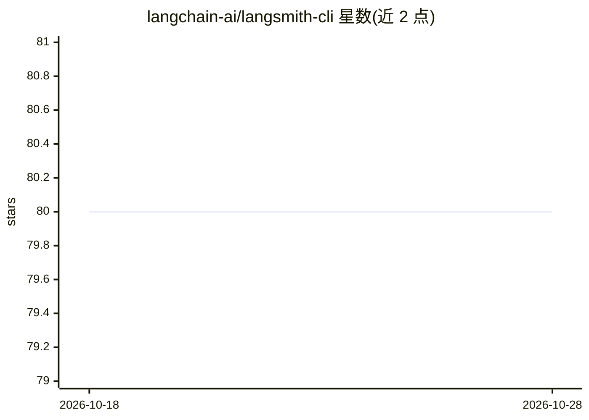

# langchain-ai/langsmith-cli

⭐ 80 · Go · MIT · 推送 2026-10-28 · [GitHub](https://github.com/langchain-ai/langsmith-cli) · 组织维护

**面向 AI 编程代理的 LangSmith 资源查询管理 CLI**

LangChain 团队提供的命令行工具，用于脚本化访问 LangSmith 的项目、trace、run、dataset、evaluator、experiment 与 thread 等资源。为 AI 编程代理（deepagents、Claude Code、Cursor 等）与开发者设计，提供分页查询、JSON 输出、OAuth/API key 认证与 profile 管理，并可将 Claude Code 或 Codex 的完整内容 trace 接入 LangSmith 项目。通过 install 脚本、GitHub Releases 二进制或包管理器安装；部分 v2 功能（trace messages 等）在自托管 <0.16 版本不可用。

## 筛选速览

| 维度 | 判定 | 备注 |
|---|---|---|
| AI 角色 | `ai-ecosystem` | LLM/agent 周边工具 |
| 许可风险 | `permissive` | MIT |
| 部署形态 | `library` | 以包/库形式分发 |
| 模型依赖 | — | README 未给出锁定关系 |
| 硬件要求 | — | 无带数字的原话,不猜 |
| 安装摩擦 | `low` | 无编译、无系统依赖或容器化 |
| 成熟度 | — | 结构信号不足 |

## 能力要点

- 覆盖 project/trace/run/dataset/evaluator/experiment/thread 等资源的命令集
- trace setup 可配置 Claude Code/Codex 向 LangSmith 发送完整 trace
- 支持 LangSmith Hub 上 agent/skill 仓库的 init/push/pull 管理
- 支持 API key、OAuth 认证与多 profile，凭据文件 owner-only 权限

## 适用场景

- 在终端或脚本中批量查询导出 LangSmith trace 与 run 数据
- 为 Claude Code / Codex 编程代理配置 LangSmith 追踪
- 管理评测数据集、evaluator 与实验结果

## 场景标签

`模型评测` `LLM 可观测性` · 领域:评测与运维

## 证据(README 行号)

> L3: An agent-first CLI for querying and managing LangSmith resources.
> L5: Built for AI coding agents (deepagents, Claude Code, Cursor, etc.) and developers who need fast, scriptable access t
> L308: Configure Claude Code or Codex to send full-content traces (prompts, responses, tool

## 星数曲线

2026-10-18 80 → 2026-10-28 80（+0）

---
*卡片 v1 · prompt 1.4 · 生成 2026-10-24 · 置信度 high · 依据 README sha `f1833e02e325` · [字段定义](../../DATASET.md)*
