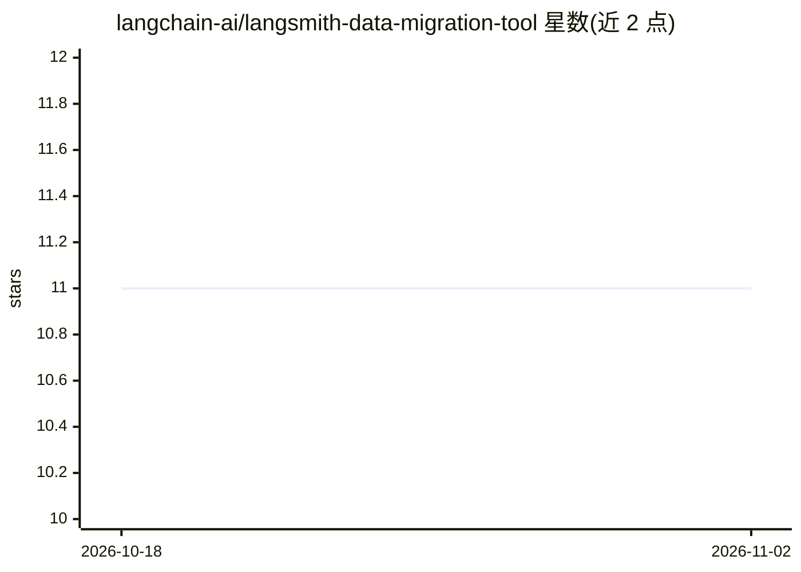

# langchain-ai/langsmith-data-migration-tool

⭐ 11 · Python · MIT · 推送 2026-10-28 · [GitHub](https://github.com/langchain-ai/langsmith-data-migration-tool) · 组织维护

**LangSmith 实例间数据迁移 CLI：迁移用户/数据集/实验/提示词等**

Python 命令行工具，面向 LangSmith 云端与自部署工作区用户，在实例之间迁移用户与角色、数据集、实验、标注队列、项目规则、提示词、图表、Engine issues 与 Fleet 资源，并支持 CSV 驱动的单实例权限同步。提供 TUI 交互式 CLI 与 --non-interactive 模式、迁移状态持久化与 resume 重试、修复报告。traces 命令仅迁移 longlived 层级的追踪且实际仅适用于自部署目标；直接迁移无断点续传，靠按时间窗口的目标端差异重跑。安装依赖 uv。

## 筛选速览

| 维度 | 判定 | 备注 |
|---|---|---|
| AI 角色 | `ai-ecosystem` | LLM/agent 周边工具 |
| 许可风险 | `permissive` | MIT |
| 部署形态 | `library` | 以包/库形式分发 |
| 模型依赖 | — | README 未给出锁定关系 |
| 硬件要求 | — | 无带数字的原话,不猜 |
| 安装摩擦 | `low` | 无编译、无系统依赖或容器化 |
| 成熟度 | — | 结构信号不足 |

## 能力要点

- 覆盖 15+ 类 LangSmith 资源的迁移，含 migrate-all 向导
- 迁移状态持久化、修复包与 resume 重试
- traces 保留 run ID/dotted_order/时间戳原文，仅限自部署目标
- 预检 canary 在迁移前验证目标端历史时间戳可接受性

## 适用场景

- 把 LangSmith 云端工作区数据迁到自部署实例
- 跨 LangSmith 实例迁移数据集、实验与提示词
- 用 CSV 对单个部署做成员与角色的访问同步

## 场景标签

 · 领域:LLM 可观测性/运维工具

## 证据(README 行号)

> L3: A Python CLI for migrating users and roles, datasets, experiments, annotation queues, project rules, prompts, charts
> L16: - **All-in-One Wizard**: Interactive migration of all resources (`migrate-all`)

## 星数曲线

2026-10-18 11 → 2026-11-02 11（+0）

---
*卡片 v1 · prompt 1.4 · 生成 2026-11-02 · 置信度 mid · 依据 README sha `756d5d948520` · [字段定义](../../DATASET.md)*
