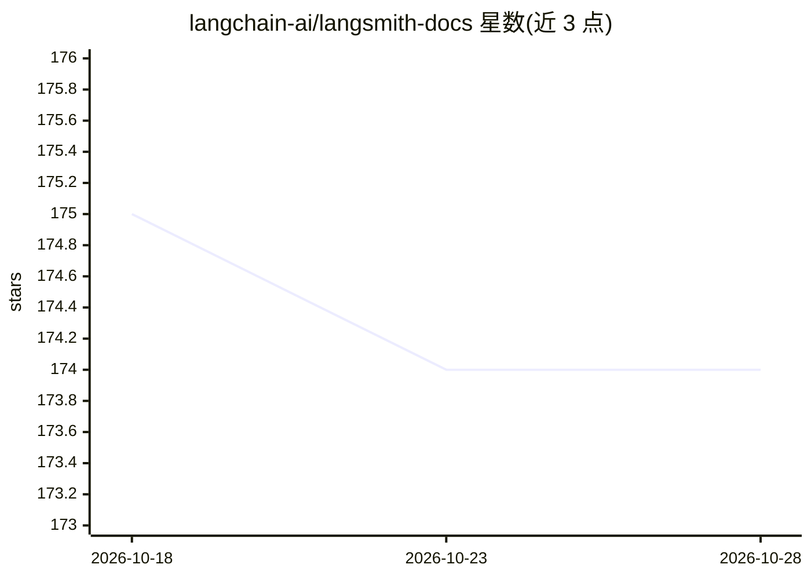

# langchain-ai/langsmith-docs

⭐ 174 · JavaScript · MIT · 推送 2026-06-28 · [GitHub](https://github.com/langchain-ai/langsmith-docs) · [官网](https://docs.langchain.com/langsmith) · 组织维护

**已废弃的 LangSmith 文档仓库，迁移至 langchain-ai/docs**

LangSmith 文档的旧仓库，现处于弃用状态：README 仅含一条警告，说明文档编辑工作已迁移至 langchain-ai/docs 仓库。仓库本身不再提供有效的安装、运行或贡献说明。基于其原有主题标签，该仓库曾涉及 LangSmith 的文档、评测与追踪内容，但当前内容无法从 README 验证。

## 筛选速览

| 维度 | 判定 | 备注 |
|---|---|---|
| AI 角色 | `ai-ecosystem` | LLM/agent 周边工具 |
| 许可风险 | `permissive` | MIT |
| 部署形态 | `None` |  |
| 模型依赖 | — | README 未给出锁定关系 |
| 硬件要求 | — | 无带数字的原话,不猜 |
| 安装摩擦 | `low` | 无编译、无系统依赖或容器化 |
| 成熟度 | — | 结构信号不足 |

## 能力要点

- README 声明仓库已弃用
- 文档编辑指向 langchain-ai/docs 仓库

## 适用场景

- 通过重定向找到 LangSmith 文档的现行维护仓库

## 场景标签

 · 领域:开发者文档

## 证据(README 行号)

> L2: > This repo is deprecated. To edit LangSmith documentation, please go to the `langchain-ai/docs` repo.

## 星数曲线

2026-10-18 175 → 2026-10-28 174（-1）

---
*卡片 v1 · prompt 1.4 · 生成 2026-10-22 · 置信度 mid · 依据 README sha `fb161ff454af` · [字段定义](../../DATASET.md)*
