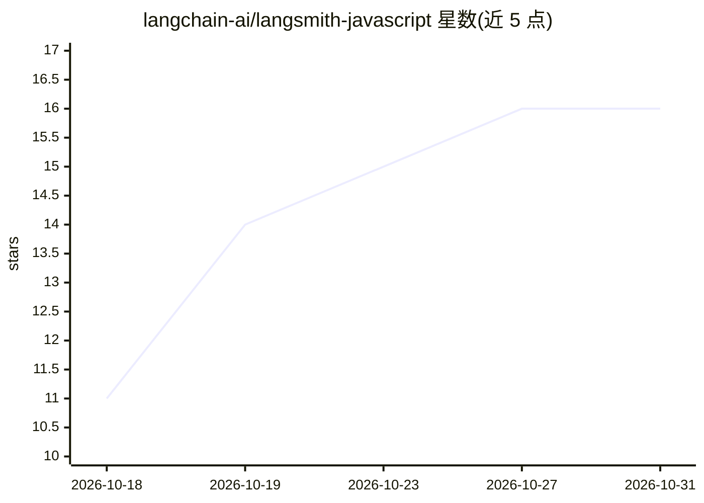

# langchain-ai/langsmith-javascript

⭐ 16 · TypeScript · MIT · 推送 2026-10-30 · [GitHub](https://github.com/langchain-ai/langsmith-javascript) · 组织维护

**面向 LLM 应用的 LangSmith 平台 TypeScript 客户端 SDK**

LangSmith 平台的 TypeScript 客户端 SDK：支持记录 LLM 应用运行追踪（traces）、创建数据集与评测运行。可通过环境变量或 RunTree 在 LangChain 应用内记录追踪，也可脱离 LangChain，用 traceable/wrapOpenAI/wrapSDK 包装任意函数、OpenAI SDK、Vercel AI SDK 或其他 SDK 实现追踪。底层附带 Stainless 生成的 REST 客户端，提供流式响应、自动重试、超时配置与自动分页。需要 LangSmith 账号与 API key。

## 筛选速览

| 维度 | 判定 | 备注 |
|---|---|---|
| AI 角色 | `ai-ecosystem` | LLM/agent 周边工具 |
| 许可风险 | `permissive` | MIT |
| 部署形态 | `library` | 以包/库形式分发 |
| 模型依赖 | — | README 未给出锁定关系 |
| 硬件要求 | — | 无带数字的原话,不猜 |
| 安装摩擦 | `low` | 无编译、无系统依赖或容器化 |
| 成熟度 | — | 结构信号不足 |

## 能力要点

- traceable/wrapOpenAI/wrapSDK 包装任意函数与 SDK 记录追踪
- RunTree 结构化追踪（llm/chain/tool 类型，支持嵌套）
- 从已存运行创建数据集用于评测
- 底层 REST 客户端支持 SSE 流式、自动重试、自动分页

## 适用场景

- 在 LangChain 应用中接入 LangSmith 记录与调试追踪
- 在自有框架或 Next.js 应用中记录 LLM 调用追踪
- 将历史运行转为数据集并评测 LLM 应用

## 场景标签

`LLM 可观测性` `模型评测` · 领域:评测与运维

## 证据(README 行号)

> L6: This package contains the TypeScript client for interacting with the LangSmith platform.
> L23: 2. Log traces.

## 星数曲线

2026-10-18 11 → 2026-10-31 16（+5）

---
*卡片 v1 · prompt 1.4 · 生成 2026-10-30 · 置信度 high · 依据 README sha `a39b4eb7aeb4` · [字段定义](../../DATASET.md)*
