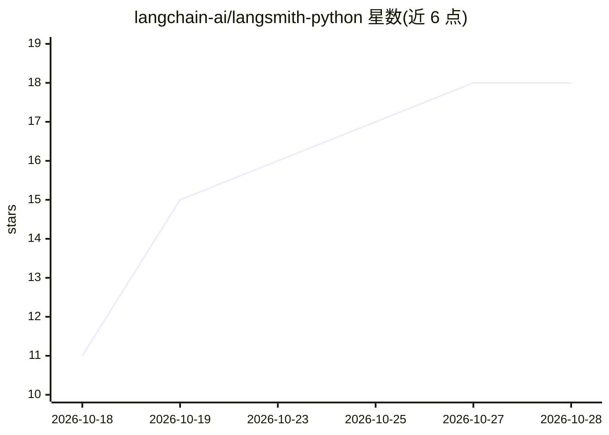

# langchain-ai/langsmith-python

⭐ 19 · Python · MIT · 推送 2026-10-28 · [GitHub](https://github.com/langchain-ai/langsmith-python) · 组织维护

**LangSmith 平台的 Python 客户端 SDK：LLM 应用追踪与评测**

LangChain 团队维护的 Python SDK，用于连接 LangSmith 平台：通过环境变量配置 API key 后，可用 @traceable 装饰器或 wrap_openai 包装器记录 LLM 调用追踪，也可在 LangChain 应用中自动记录。支持将运行转为数据集、运行评测与自动反馈生成。面向需要调试、评测 LLM 应用与 agent 的开发团队；包内附带自动分页、重试、超时配置的生成式 REST 客户端及默认启用的 pytest 插件。需注册 LangSmith 账号并持有 API key。

## 筛选速览

| 维度 | 判定 | 备注 |
|---|---|---|
| AI 角色 | `ai-ecosystem` | LLM/agent 周边工具 |
| 许可风险 | `permissive` | MIT |
| 部署形态 | `library` | 以包/库形式分发 |
| 模型依赖 | — | README 未给出锁定关系 |
| 硬件要求 | — | 无带数字的原话,不猜 |
| 安装摩擦 | `low` | 无编译、无系统依赖或容器化 |
| 成熟度 | — | 结构信号不足 |

## 能力要点

- @traceable 装饰器与 wrap_openai 包装器实现嵌套追踪
- 运行记录可转为数据集并运行评测（StringEvaluator）
- 内置 pytest 插件，将数据集与评测定义为 pytest 用例
- 生成式 REST 客户端支持同步/异步、SSE 流式与自动分页

## 适用场景

- 调试与原型阶段记录 LLM 应用与 agent 的调用追踪
- 运行基准评测并用收集的数据持续改进模型
- 在 pytest 测试用例中定义数据集与评估

## 场景标签

`模型评测` `LLM 可观测性` · 领域:评测与运维

## 证据(README 行号)

> L6: This package contains the Python client for interacting with the LangSmith platform.
> L27: LangSmith helps you and your team develop and evaluate language models and intelligent agents. It is compatible wit
> L139: For generating automated feedback on individual runs, you can run evaluations directly using the LangSmith client.

## 星数曲线

2026-10-18 11 → 2026-10-28 18（+7）

---
*卡片 v1 · prompt 1.4 · 生成 2026-10-28 · 置信度 high · 依据 README sha `97c8382323ed` · [字段定义](../../DATASET.md)*
