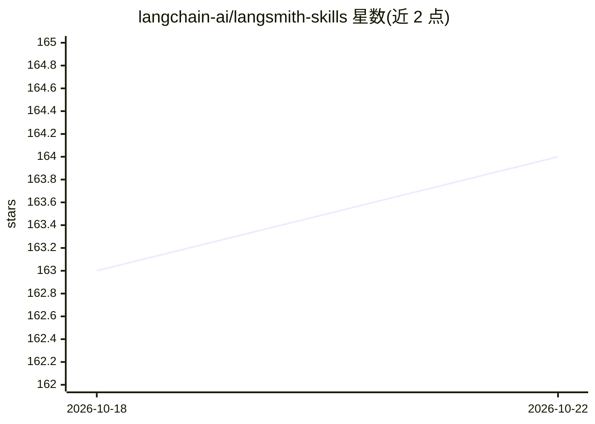

# langchain-ai/langsmith-skills

⭐ 164 · Python · MIT · 推送 2026-10-20 · [GitHub](https://github.com/langchain-ai/langsmith-skills) · 组织维护

**供编码代理使用的 LangSmith 观测与评测技能包**

LangChain 团队维护的 agent 技能集合：为 Claude Code、Cursor、Windsurf、Deep Agents CLI 等编码代理提供 5 个 LangSmith 技能，包括查询导出 trace、从 trace 生成评测数据集、创建自定义评测器、构建 LangSmith Custom Apps 以及设计线上评测器，部分技能附带 Python/TypeScript 辅助脚本。通过 npx skills、Claude Code 插件市场或 install.sh 脚本安装，需设置 LANGSMITH_API_KEY。项目处于早期开发阶段，API 与技能内容可能变更。

## 筛选速览

| 维度 | 判定 | 备注 |
|---|---|---|
| AI 角色 | `ai-ecosystem` | LLM/agent 周边工具 |
| 许可风险 | `permissive` | MIT |
| 部署形态 | `library` | 以包/库形式分发 |
| 模型依赖 | — | README 未给出锁定关系 |
| 硬件要求 | — | 无带数字的原话,不猜 |
| 安装摩擦 | `low` | 无编译、无系统依赖或容器化 |
| 成熟度 | `idea` | |

## 能力要点

- 5 个 LangSmith 技能：trace 查询、评测数据集生成、自定义评测器、Custom Apps、线上评测器
- 支持 skills.sh 兼容的多种编码代理（Claude Code、Cursor、Windsurf、Goose 等）
- 三种安装途径：npx skills、Claude Code 插件、install.sh 脚本
- 部分技能附带 Python/TypeScript 辅助脚本

## 适用场景

- 在编码代理中直接查询和导出 LangSmith trace
- 从生产 trace 生成评测数据集与自定义评测器
- 为 LangSmith 构建和分享 Custom Apps

## 场景标签

`模型评测` · 领域:评测与运维

## 证据(README 行号)

> L5: Agent skills for observing and evaluating LLM applications with LangSmith. Query traces, build evaluation datasets, 
> L82: - **langsmith-trace** - Query and export traces (includes helper scripts)
> L86: - **langsmith-online-eval-engineering** - Design, test, and attach online evaluators for production traces and conv

## 星数曲线

2026-10-18 163 → 2026-10-22 164（+1）

---
*卡片 v1 · prompt 1.4 · 生成 2026-10-22 · 置信度 high · 依据 README sha `a77eae7d1ba5` · [字段定义](../../DATASET.md)*
